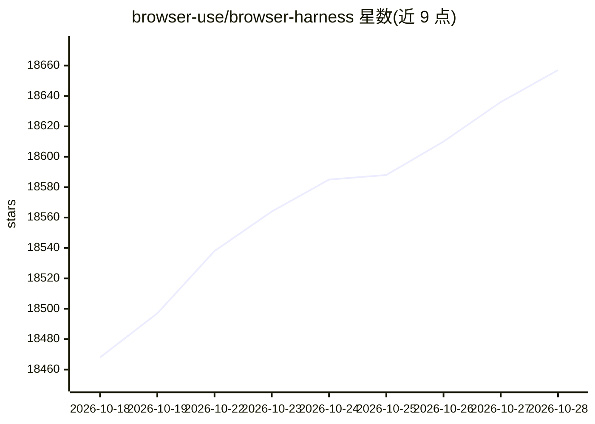

# browser-use/browser-harness

⭐ 18,657 · Python · MIT · 推送 2026-10-25 · [GitHub](https://github.com/browser-use/browser-harness) · [官网](https://browser-harness.com) · 组织维护

**让 Claude Code/Codex/Cursor 驱动你已登录的真实 Chrome 的工具**

通过 Chrome DevTools Protocol (CDP) 将编码 agent（Claude Code、Codex、Cursor 及任意 MCP 客户端）连接到用户本人已登录的真实 Chrome，可打开页面、点击、输入、读取与下载。设置方式是把一段 setup prompt 粘贴给编码 agent，由 agent 用 uv + Python 3.12 安装并注册技能；agent 在本地工作区自行编写缺失的 helper 以扩展能力。另提供 browser-harness-mcp 以 MCP server 形式供各客户端使用，并与 Playwright MCP 等工具附有基准对比与场景建议。

## 筛选速览

| 维度 | 判定 | 备注 |
|---|---|---|
| AI 角色 | `ai-ecosystem` | LLM/agent 周边工具 |
| 许可风险 | `permissive` | MIT |
| 部署形态 | `None` |  |
| 模型依赖 | — | README 未给出锁定关系 |
| 硬件要求 | — | 无带数字的原话,不猜 |
| 安装摩擦 | `low` | 无编译、无系统依赖或容器化 |
| 成熟度 | — | 结构信号不足 |

## 动量与使用信号

- 维护:`active` — 距上次 push 3.3 天,年发版 14,86 位贡献者
- 涨星:近 1 天 **+15**(自 20261016 起算)
- 安装:github 包 `release-assets` 月下载无数据
- 平台:— · 协议:MCP

## 能力要点

- 经 CDP 驱动用户本人已登录的真实 Chrome 浏览器
- 一段 setup prompt 即可让编码 agent 完成安装与连接
- agent 在本地工作区自写 helper，任务越多能力越丰富
- 提供 browser-harness-mcp 供任意 MCP 客户端使用

## 适用场景

- 让 Claude Code/Codex/Cursor 代我操作已登录的网页账号
- 用自然语言让 agent 下载、读取网页内容
- 在 Browser Use Cloud 中并行扩展浏览器任务

## 场景标签

`浏览器自动化` · 领域:效率与自动化

## 证据(README 行号)

> L5: Browser Harness lets Claude Code, Codex or Cursor use your real Chrome browser: open pages, click, type, read and do
> L92: `browser-harness-mcp` exposes the browser control helpers as MCP tools over

## 星数曲线

2026-10-18 18,468 → 2026-10-28 18,657（+189）

---
*卡片 v1 · prompt 1.4 · 生成 2026-10-20 · 置信度 high · 依据 README sha `ddf1a7dc5131` · [字段定义](../../DATASET.md)*
