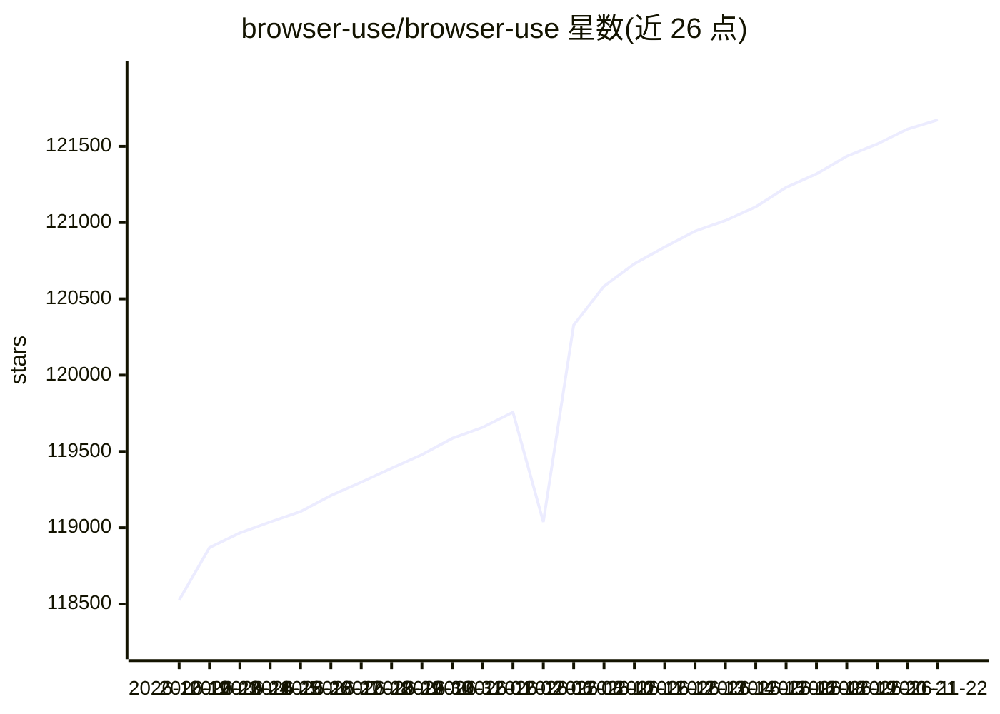

# browser-use/browser-use

⭐ 121,673 · Python · MIT · 推送 2026-11-21 · [GitHub](https://github.com/browser-use/browser-use) · [官网](https://browser-use.com) · 组织维护

**开源 Python 浏览器代理库：让 LLM 驱动真实浏览器执行任务**

以 Python 库、CLI 与全托管云三种形态提供的浏览器代理：用户给出任务后，模型在持久 REPL 中编写 Python，通过 Chrome DevTools Protocol 操作真实浏览器。支持云端隐身浏览器与本地 Chrome/Chromium/Edge，任意 LLM 可接入，MIT 许可。依赖 Python 3.11+，默认需 Browser Use Cloud API key，同时提供 Cloud 托管 agent API 与计费的网页搜索功能。

## 筛选速览

| 维度 | 判定 | 备注 |
|---|---|---|
| AI 角色 | `ai-native` | 本体是模型或模型工具 |
| 许可风险 | `permissive` | MIT |
| 部署形态 | `library` | 以包/库形式分发 |
| 模型依赖 | — | README 未给出锁定关系 |
| 硬件要求 | — | 无带数字的原话,不猜 |
| 安装摩擦 | `low` | 无编译、无系统依赖或容器化 |
| 成熟度 | — | 结构信号不足 |

## 动量与使用信号

- 维护:`active` — 距上次 push 1.1 天,年发版 49,361 位贡献者
- 涨星:近 1 天 **+173**(自 20261016 起算)
- 下载:GitHub Release 附件 累计 45(100 个 release)
- 平台:— · 协议:OPENAI-API / MCP / OLLAMA

## 能力要点

- 模型写 Python + REPL + CDP 构成整个 agent（基于 Pydantic AI）
- 支持云端隐身浏览器与本地浏览器，可接任意 LLM
- 提供结构化输出、密钥注入、域名限制、自定义工具等能力
- 运行后由模型 judge 评估任务成败并检测提示注入

## 适用场景

- 让 AI 自动在网页上完成预约、填表等操作
- 在自己的 Python 代码中运行开源浏览器 agent
- 用托管云浏览器批量扩展浏览器自动化任务

## 场景标签

`浏览器自动化` · 领域:效率与自动化

## 证据(README 行号)

> L23: The open-source browser agent. Give it a task and the model does it in a real browser by writing Python: one persis
> L46:  Three ways to use Browser Use: the hosted V4 agent, the Browser Use CLI, or the open source Python library. All th

## 星数曲线

2026-10-19 118,526 → 2026-11-22 121,673（+3,147）

---
*卡片 v1 · prompt 1.4 · 生成 2026-11-22 · 置信度 high · 依据 README sha `26f5d99ee72c` · [字段定义](../../DATASET.md)*
