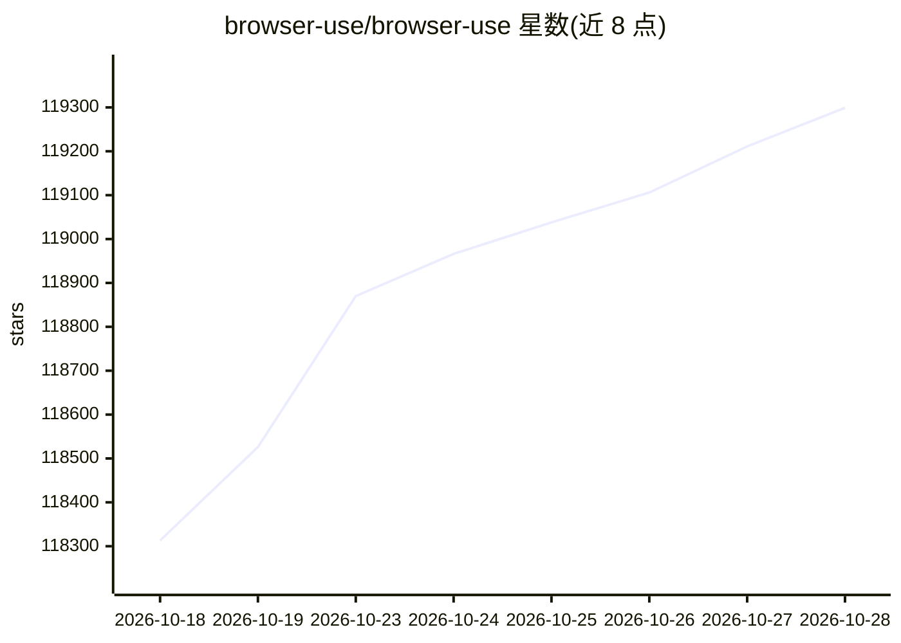

# browser-use/browser-use

⭐ 119,299 · Python · MIT · 推送 2026-10-27 · [GitHub](https://github.com/browser-use/browser-use) · [官网](https://browser-use.com) · 组织维护

**面向 AI agent 的开源浏览器自动化 Python 库**

提供 Python 库、CLI 和全托管云三条使用路径：库可嵌入应用运行浏览器 agent，支持本地或云浏览器、自定义工具与结构化输出；CLI 让现有 agent 获得浏览器控制能力；云服务提供带隐身、住宅代理与 CAPTCHA 处理的托管浏览器及托管 agent API。库本身 MIT 协议免费，模型推理与云浏览器按用量另计；CAPTCHA 处理效果依赖具体站点。

## 筛选速览

| 维度 | 判定 | 备注 |
|---|---|---|
| AI 角色 | `ai-native` | 本体是模型或模型工具 |
| 许可风险 | `permissive` | MIT |
| 部署形态 | `library` | 以包/库形式分发 |
| 模型依赖 | locked-api |  |
| 硬件要求 | — | 无带数字的原话,不猜 |
| 安装摩擦 | `low` | 无编译、无系统依赖或容器化 |
| 成熟度 | — | 结构信号不足 |

## 动量与使用信号

- 维护:`active` — 距上次 push 1.1 天,年发版 49,361 位贡献者
- 涨星:近 1 天 **+173**(自 20261016 起算)
- 下载:GitHub Release 附件 累计 45(100 个 release)
- 平台:— · 协议:OPENAI-API / MCP / OLLAMA

## 能力要点

- Python 库内嵌 Agent 运行时，支持本地/云浏览器与自定义 Tools 注册
- 为 Claude 提供 31 个浏览器动作的工具集集成，可经 CDP 控制远程浏览器
- ChatBrowserUse 网关可调用 Claude/GPT/Gemini 等模型，也可用 Ollama 本地模型
- 云浏览器按 $0.02/小时计费，支持 Docker/CI/serverless 场景

## 适用场景

- 让 AI agent 自动完成网页预订、查询等操作
- 在自有 Python 应用中嵌入可配置模型的浏览器 agent
- 给 Claude Code 等编码 agent 增加浏览器控制能力
- 在无 Chrome 的服务器/CI 环境用云浏览器跑自动化

## 场景标签

`浏览器自动化` · 领域:效率与自动化

## 证据(README 行号)

> L41:  Three ways to use Browser Use: the hosted V4 agent, the Browser Use CLI, or the open source Python library. All th
> L160: - **Python Library:** Run the open source agent in your own application, with custom tools, structured output, and
> L202: The Python library is free and MIT-licensed. Model inference and hosted browsers are separate: API providers, incl

## 星数曲线

2026-10-18 118,313 → 2026-10-28 119,299（+986）

---
*卡片 v1 · prompt 1.4 · 生成 2026-10-18 · 置信度 high · 依据 README sha `3e35ea856eab` · [字段定义](../../DATASET.md)*
