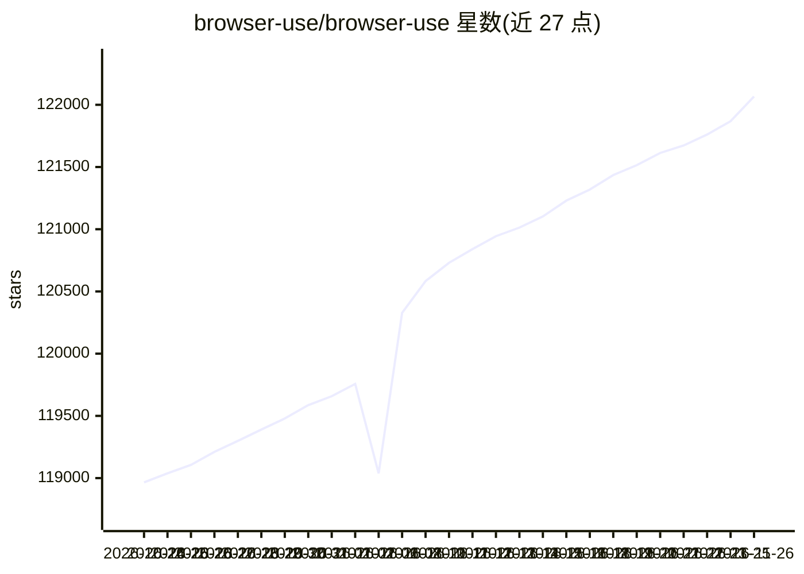

# browser-use/browser-use

⭐ 122,067 · Python · MIT · 推送 2026-11-24 · [GitHub](https://github.com/browser-use/browser-use) · [官网](https://browser-use.com) · 组织维护

**开源 Python 浏览器 agent 库：LLM 驱动真实浏览器执行任务**

以 Python 库、CLI 和托管云三种形态提供的浏览器 agent：模型在持久 REPL 中编写 Python，通过 Chrome DevTools Protocol 驱动真实浏览器完成任务。支持 Browser Use Cloud 浏览器（按小时计费，含隐身、验证码处理、住宅代理）或本地 Chrome/Chromium，可接入任意 LLM。基于 Pydantic AI 构建，提供结构化输出、文件上传下载、域名限制、secrets 注入、自定义工具、运行结果评判（Judge）与匿名遥测。要求 Python 3.11+，默认使用其网关模型 bu-4.0 与云浏览器，需 API key；MIT 许可，另有面向企业的托管方案。

## 筛选速览

| 维度 | 判定 | 备注 |
|---|---|---|
| AI 角色 | `ai-ecosystem` | LLM/agent 周边工具 |
| 许可风险 | `permissive` | MIT |
| 部署形态 | `library` | 以包/库形式分发 |
| 模型依赖 | — | README 未给出锁定关系 |
| 硬件要求 | — | 无带数字的原话,不猜 |
| 安装摩擦 | `low` | 无编译、无系统依赖或容器化 |
| 成熟度 | — | 结构信号不足 |

## 动量与使用信号

- 维护:`active` — 距上次 push 1.1 天,年发版 49,361 位贡献者
- 涨星:近 1 天 **+173**(自 20261016 起算)
- 下载:GitHub Release 附件 累计 45(100 个 release)
- 平台:— · 协议:OPENAI-API / MCP / OLLAMA

## 能力要点

- 模型写 Python 在持久 REPL 中经原始 CDP 驱动浏览器
- 支持云浏览器与本地 Chrome/Chromium/Edge 多种 Browser 模式
- 内置 ChatAnthropic/ChatGoogle 及任意 Pydantic AI 模型字符串接入
- 提供 Judge 运行评判、域名限制、secrets 掩码与自定义 @tools.action

## 适用场景

- 让 agent 在真实浏览器里完成预约、填表等网页操作
- 用 Python 库在自己的代码中运行浏览器自动化任务
- 通过 CLI 把浏览器操作注册为可给编码 agent 使用的技能
- 需要隐身浏览器与验证码处理时调用托管云浏览器

## 场景标签

`浏览器自动化` · 领域:效率与自动化

## 证据(README 行号)

> L23: The open-source browser agent. Give it a task and the model does it in a real browser by writing Python: one persis
> L50: - **Path 3: Python Library:** Run the open source Browser Use agent locally from your own code.
> L72: > **browser-use 1.0.** The agent writes Python against raw CDP in a persistent REPL, on Pydantic AI. Coming from 0.

## 星数曲线

2026-10-24 118,966 → 2026-11-26 122,067（+3,101）

---
*卡片 v1 · prompt 1.4 · 生成 2026-11-23 · 置信度 high · 依据 README sha `a8abdc75dcd4` · [字段定义](../../DATASET.md)*
