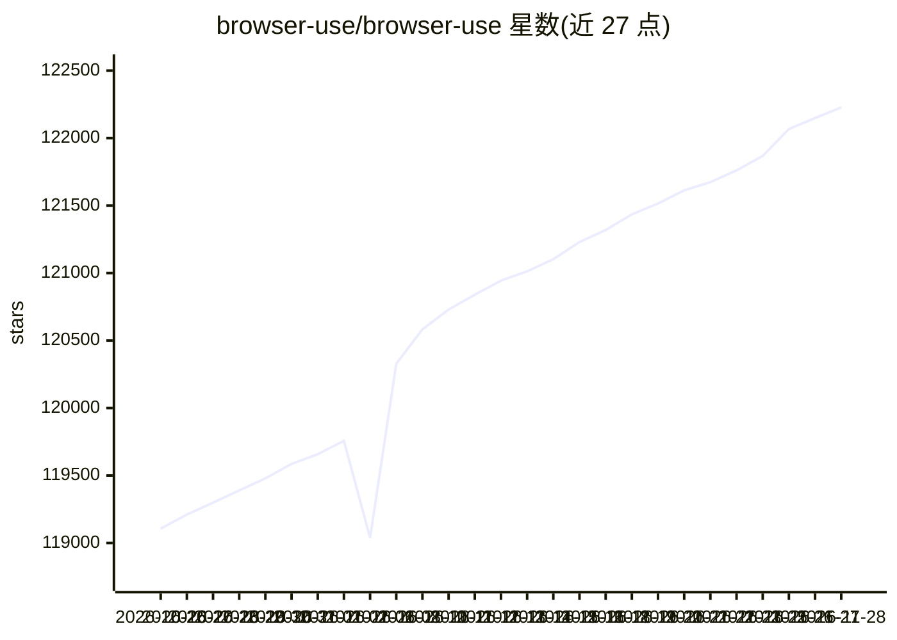

# browser-use/browser-use

⭐ 122,227 · Python · MIT · 推送 2026-11-27 · [GitHub](https://github.com/browser-use/browser-use) · [官网](https://browser-use.com) · 组织维护

**开源 Python 浏览器 agent 库：给模型一个真实浏览器执行任务**

开源 MIT 许可的浏览器 agent 库（含 TypeScript 版），提供三种使用路径：全托管云 agent、CLI、本地 Python 库。核心机制是模型在持久 REPL 中针对原始 Chrome DevTools Protocol 写 Python 驱动浏览器。默认使用官方网关模型与云浏览器（按 browser 小时计费），也可搭配本地浏览器与自有 LLM。支持结构化输出、文件上传下载、密钥遮蔽、域名限制、自定义工具、运行结果判定（judge）与匿名遥测。要求 Python 3.11+，版本需精确锁定。

## 筛选速览

| 维度 | 判定 | 备注 |
|---|---|---|
| AI 角色 | `ai-ecosystem` | LLM/agent 周边工具 |
| 许可风险 | `permissive` | MIT |
| 部署形态 | `library` | 以包/库形式分发 |
| 模型依赖 | local-ok | 支持本地模型 |
| 硬件要求 | — | 无带数字的原话,不猜 |
| 安装摩擦 | `low` | 无编译、无系统依赖或容器化 |
| 成熟度 | — | 结构信号不足 |

## 动量与使用信号

- 维护:`active` — 距上次 push 1.1 天,年发版 49,361 位贡献者
- 涨星:近 1 天 **+173**(自 20261016 起算)
- 下载:GitHub Release 附件 累计 45(100 个 release)
- 平台:— · 协议:OPENAI-API / MCP / OLLAMA

## 能力要点

- 模型在持久 REPL 中对原始 CDP 写 Python，驱动本地或云浏览器
- 内置 ChatAnthropic/ChatGoogle，或任意 Pydantic AI 模型字符串（如 groq）
- 结构化输出、域名限制、敏感数据遮蔽与运行后 judge 判定
- 提供 CLI（含 skill install、--doctor）与 MCP server

## 适用场景

- 让 agent 在真实浏览器中完成订票、填表等网页任务
- 用自有 LLM 驱动本地 Chrome/Chromium 做浏览器自动化
- 在服务器/CI/容器中运行浏览器 agent 并获取下载文件

## 场景标签

`浏览器自动化` `Agent 框架` · 领域:Agent 开发

## 证据(README 行号)

> L23: The open-source browser agent. Give it a task and the model does it in a real browser by writing Python: one persis
> L46:  Three ways to use Browser Use: the hosted V4 agent, the Browser Use CLI, or the open source Python library. All th

## 星数曲线

2026-10-26 119,106 → 2026-11-28 122,227（+3,121）

---
*卡片 v1 · prompt 1.4 · 生成 2026-11-27 · 置信度 high · 依据 README sha `a19a296ae04c` · [字段定义](../../DATASET.md)*
