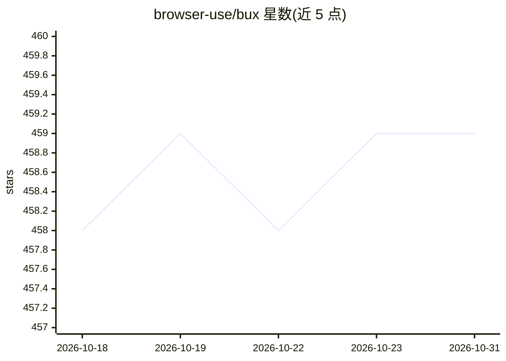

# browser-use/bux

⭐ 459 · Python · MIT · 推送 2026-10-23 · [GitHub](https://github.com/browser-use/bux) · [官网](https://www.tiktok.com/@browser_use/video/7639824093721758989) · 组织维护

**在自有 VPS 上 7x24 运行 Claude Code 浏览器代理的安装与托管方案**

由 browser-use 团队提供的工具箱：通过一条 curl 安装脚本把 Claude Code、持久化 Chromium 会话（经 browser-harness 接入 Browser Use Cloud，CDP over WebSocket）、Telegram 机器人和 web 终端部署为 Ubuntu VPS 上的三个 systemd 服务，状态存于 /home/bux，重启后保留 cookies 与聊天记录。遇到登录墙/2FA/CAPTCHA 时生成 live view URL 等待人工处理。需 Browser Use Cloud API key 与 Anthropic API key 或 Claude Max 订阅；另提供云端托管与每月 1000 美元的托管试点服务。

## 筛选速览

| 维度 | 判定 | 备注 |
|---|---|---|
| AI 角色 | `ai-ecosystem` | LLM/agent 周边工具 |
| 许可风险 | `permissive` | MIT |
| 部署形态 | `None` |  |
| 模型依赖 | locked-api |  |
| 硬件要求 | — | 无带数字的原话,不猜 |
| 安装摩擦 | `low` | 无编译、无系统依赖或容器化 |
| 成熟度 | — | 结构信号不足 |

## 能力要点

- 单条 curl 脚本在 Ubuntu 22.04+（≥2GB RAM）上部署三个 systemd 服务
- Chromium 会话经 browser-harness 接入 Browser Use Cloud，cookies 持久化
- Telegram bot 远程对话驱动代理；遇登录墙/2FA/CAPTCHA 转人工 live view
- 代理状态存于 /home/bux，重启保留 cookies、技能与聊天历史

## 适用场景

- 租一台便宜 VPS 跑一个随时可通过 Telegram 联系的浏览器代理
- 让 Claude Code 长期登录网站并保持会话执行自动化任务
- 不想自己运维时使用官方云端托管或付费托管试点

## 场景标签

`浏览器自动化` · 领域:效率与自动化

## 证据(README 行号)

> L39: - **Claude Code** logged in and always on
> L56:                                  ├──► claude -p  ──► browser-harness ──► BU Cloud

## 星数曲线

2026-10-18 458 → 2026-10-31 459（+1）

---
*卡片 v1 · prompt 1.4 · 生成 2026-10-21 · 置信度 high · 依据 README sha `503aec60bf48` · [字段定义](../../DATASET.md)*
