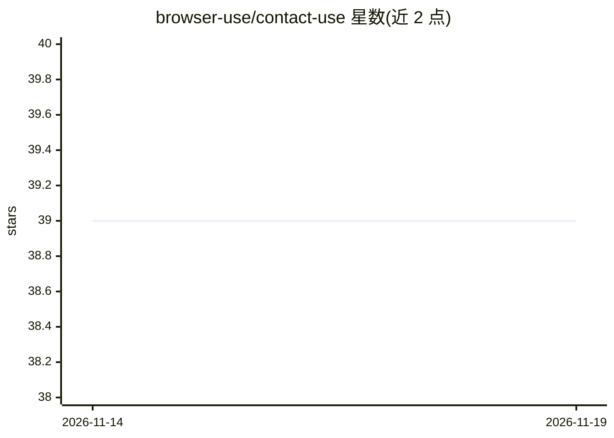

# browser-use/contact-use

⭐ 39 · HTML · 推送 2026-11-08 · [GitHub](https://github.com/browser-use/contact-use) · 组织维护

**用 LLM 浏览器代理查找联系任意个人或组织的方式**

基于 browser-use 的应用：输入联系人或组织，由 LLM 驱动的浏览器代理自动浏览网页寻找最佳联系方式，面向需要快速联系他人的销售/外联场景用户。以 Python Web 服务形式提供：克隆仓库后用 uv sync 安装依赖，运行 server.py 在本地 8000 端口启动界面。运行需设置 OPENAI_API_KEY 或 ANTHROPIC_API_KEY，默认使用 claude-sonnet-4-20250514 或 gpt-4.1-mini 模型。README 较简短，未说明支持的联系渠道类型与具体输出格式。

## 筛选速览

| 维度 | 判定 | 备注 |
|---|---|---|
| AI 角色 | `ai-native` | 本体是模型或模型工具 |
| 许可风险 | `none` | — |
| 部署形态 | `None` |  |
| 模型依赖 | — | README 未给出锁定关系 |
| 硬件要求 | — | 无带数字的原话,不猜 |
| 安装摩擦 | `low` | 无编译、无系统依赖或容器化 |
| 成熟度 | — | 结构信号不足 |

## 能力要点

- 基于 browser-use 的 LLM 浏览器代理自动查找联系方式
- 支持 OpenAI 与 Anthropic API key，自动选择默认模型
- 本地 Web 界面（localhost:8000）操作

## 适用场景

- 临时需要联系某人但找不到渠道时让代理代查
- 销售/外联场景收集个人或组织的联系方式

## 场景标签

`浏览器自动化` · 领域:效率与自动化

## 证据(README 行号)

> L5: Use browser-use's LLM-powered browser agent to find the best way to reach them.
> L13: First set either `OPENAI_API_KEY` or `ANTHROPIC_API_KEY` in your environment, it will automatically use `claude-son

## 星数曲线

2026-11-14 39 → 2026-11-19 39（+0）

---
*卡片 v1 · prompt 1.4 · 生成 2026-11-18 · 置信度 high · 依据 README sha `e7ed04edd931` · [字段定义](../../DATASET.md)*
