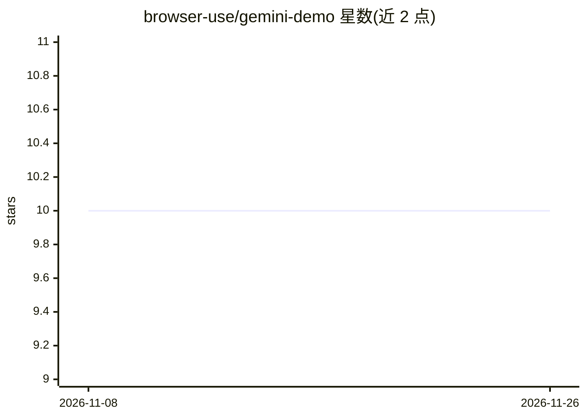

# browser-use/gemini-demo

⭐ 10 · Python · MIT · 推送 2026-11-08 · [GitHub](https://github.com/browser-use/gemini-demo) · 组织维护

**用 Browser-Use 与 Gemini 自动填写并提交申请表单的示例**

一个演示模板：通过 Browser-Use 驱动浏览器代理，调用 Google 的 gemini-3-pro-preview 模型完成申请表的自动填写——导航到页面、填入个人信息、上传 PDF 文档、补全可选字段并提交确认。支持使用自带示例数据或自定义 JSON 数据与 PDF 运行。安装依赖用 uv sync，运行前需在 .env 中配置 Google API key。属于演示性质的模板工程，非通用工具库。

## 筛选速览

| 维度 | 判定 | 备注 |
|---|---|---|
| AI 角色 | `ai-native` | 本体是模型或模型工具 |
| 许可风险 | `permissive` | MIT |
| 部署形态 | `None` |  |
| 模型依赖 | — | README 未给出锁定关系 |
| 硬件要求 | — | 无带数字的原话,不猜 |
| 安装摩擦 | `low` | 无编译、无系统依赖或容器化 |
| 成熟度 | — | 结构信号不足 |

## 能力要点

- Browser-Use 驱动浏览器代理完成表单导航、填写、上传、提交全流程
- 使用 Google gemini-3-pro-preview 模型执行多步表单填写任务
- 支持自定义 JSON 个人数据与 PDF 文档输入
- 自带示例数据可一键运行演示

## 适用场景

- 自动填写并提交在线申请表单
- 作为 Browser-Use + Gemini 表单自动化的起步模板参考
- 批量提交包含个人信息与文档上传的申请

## 场景标签

`浏览器自动化` · 领域:效率与自动化

## 证据(README 行号)

> L3: Automate application form submission using Browser-Use and Gemini 3 Pro Preview with AI-powered form filling.
> L15: The template uses Google's `gemini-3-pro-preview` model which excels at complex multi-step tasks like form filling.

## 星数曲线

2026-11-08 10 → 2026-11-26 10（+0）

---
*卡片 v1 · prompt 1.4 · 生成 2026-11-19 · 置信度 high · 依据 README sha `41bacedcd422` · [字段定义](../../DATASET.md)*
