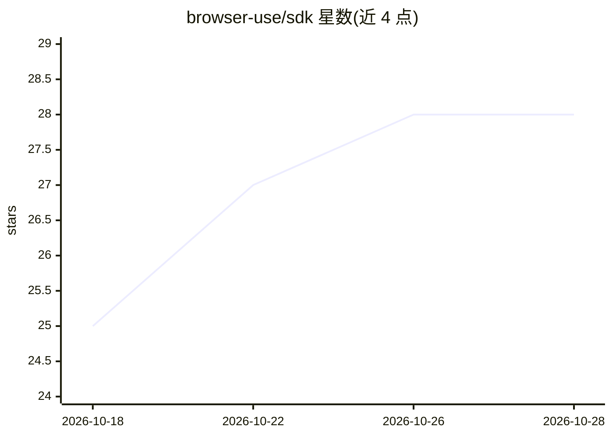

# browser-use/sdk

⭐ 28 · Python · 推送 2026-10-24 · [GitHub](https://github.com/browser-use/sdk) · [官网](https://docs.cloud.browser-use.com) · 组织维护

**Browser Use Cloud 官方多语言 SDK：接入云端浏览器代理与托管浏览器**

Browser Use Cloud 的官方 SDK 集合，提供 Python（PyPI）与 TypeScript（npm）两种语言的 browser-use-sdk 包。功能分两条路径：一是通过 V4 接口给浏览器代理下发任务并接收完成结果；二是通过 V4 SDK 的 browser 资源或 V4 REST API 创建与控制托管浏览器实例。面向需要将云端浏览器自动化或网页代理能力接入自身应用的开发者，文档位于 docs.browser-use.com，入门引导指向 Cloud quickstart。

## 筛选速览

| 维度 | 判定 | 备注 |
|---|---|---|
| AI 角色 | `ai-ecosystem` | LLM/agent 周边工具 |
| 许可风险 | `none` | — |
| 部署形态 | `library` | 以包/库形式分发 |
| 模型依赖 | — | README 未给出锁定关系 |
| 硬件要求 | — | 无带数字的原话,不猜 |
| 安装摩擦 | `low` | 无编译、无系统依赖或容器化 |
| 成熟度 | — | 结构信号不足 |

## 能力要点

- 官方维护的 Python 与 TypeScript 双语言 SDK
- V4 接口支持向代理下发任务并获取结果
- 可通过 V4 SDK browser 资源或 REST API 控制托管浏览器

## 适用场景

- 在我的应用里调用云端浏览器代理执行网页任务
- 程序化创建和操控托管浏览器实例
- 用 Python 或 TypeScript 集成 Browser Use Cloud 服务

## 场景标签

`浏览器自动化` · 领域:效率与自动化

## 证据(README 行号)

> L5: Official SDKs for Browser Use Cloud.
> L7: - **Browser Use Agents:** use the explicit V4 interface to give an agent a task

## 星数曲线

2026-10-18 25 → 2026-10-28 28（+3）

---
*卡片 v1 · prompt 1.4 · 生成 2026-10-26 · 置信度 mid · 依据 README sha `8f37e82e8238` · [字段定义](../../DATASET.md)*
