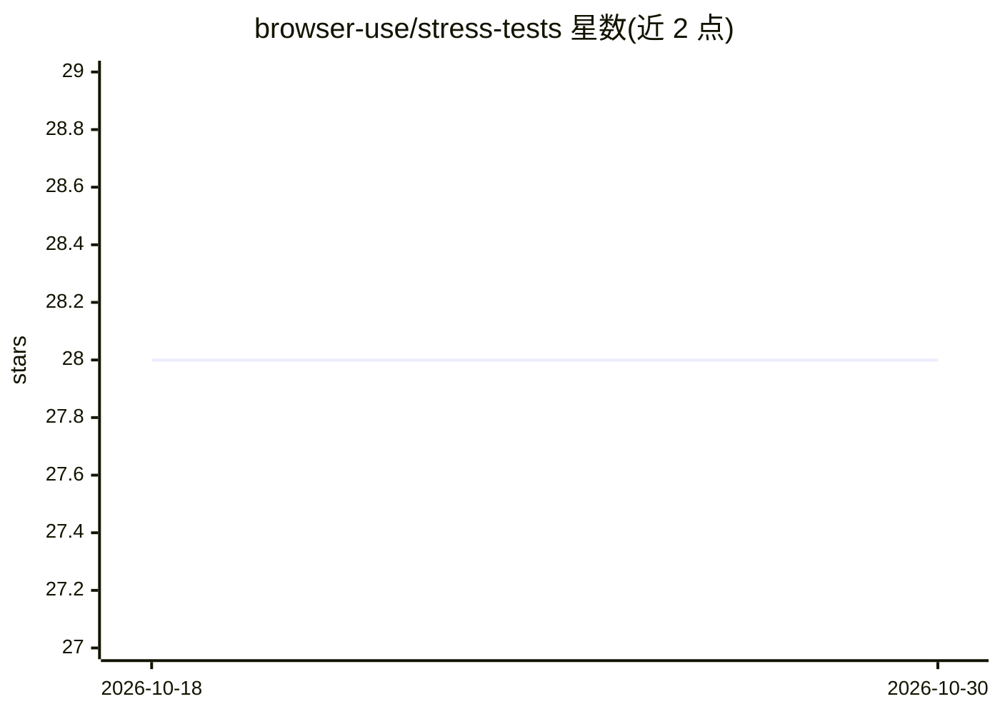

# browser-use/stress-tests

⭐ 28 · HTML · 推送 2026-05-15 · [GitHub](https://github.com/browser-use/stress-tests) · [官网](https://browser-use.github.io/stress-tests/challenge.html) · 组织维护

**用于评测 browser-use 的困难 Web 表单测试场景集合**

browser-use 官方组织的压力测试场景库：收录 27 种主流前端技术栈（React/Angular/Vue/Svelte/Ember 等）实现的表单页面，每个表单覆盖全部标准输入类型、日期选择器、禁用字段、干扰弹窗与校验，提交成功统一显示固定 secret 便于评测校验。另含 Shadow DOM、嵌套 iframe、隐藏标签、非拉丁字符集、contenteditable 等特殊难例。纯前端静态 HTML，无需构建，直接在浏览器打开即可测试自动填表或 agent 能力。

## 筛选速览

| 维度 | 判定 | 备注 |
|---|---|---|
| AI 角色 | `ai-knowledge` | 知识聚合/清单类 |
| 许可风险 | `none` | — |
| 部署形态 | `None` |  |
| 模型依赖 | — | README 未给出锁定关系 |
| 硬件要求 | — | 无带数字的原话,不猜 |
| 安装摩擦 | `low` | 无编译、无系统依赖或容器化 |
| 成熟度 | — | 结构信号不足 |

## 能力要点

- 27 种前端框架/库实现的表单覆盖 20+ 场景维度
- 提交成功统一显示 secret 便于自动评测校验
- Wufoo 风格表单专门挑战自动填充系统（蜜罐字段、拆分字段等）
- 纯前端项目、无构建步骤，静态 HTML 直接运行

## 适用场景

- 评测浏览器自动化 agent 的表单理解与填写能力
- 测试自动填表扩展的字段识别与填充准确性
- 对比不同浏览器 agent 在困难 DOM 结构下的表现

## 场景标签

`模型评测` · 领域:评测与运维

## 证据(README 行号)

> L3: > - Guided Evaluation Challenge: https://browser-use.github.io/stress-tests/challenge.html
> L72: This is a purely frontend project with no build steps required. All forms are self-contained in their respective HT

## 星数曲线

2026-10-18 28 → 2026-10-30 28（+0）

---
*卡片 v1 · prompt 1.4 · 生成 2026-10-26 · 置信度 high · 依据 README sha `dd8617f7f968` · [字段定义](../../DATASET.md)*
