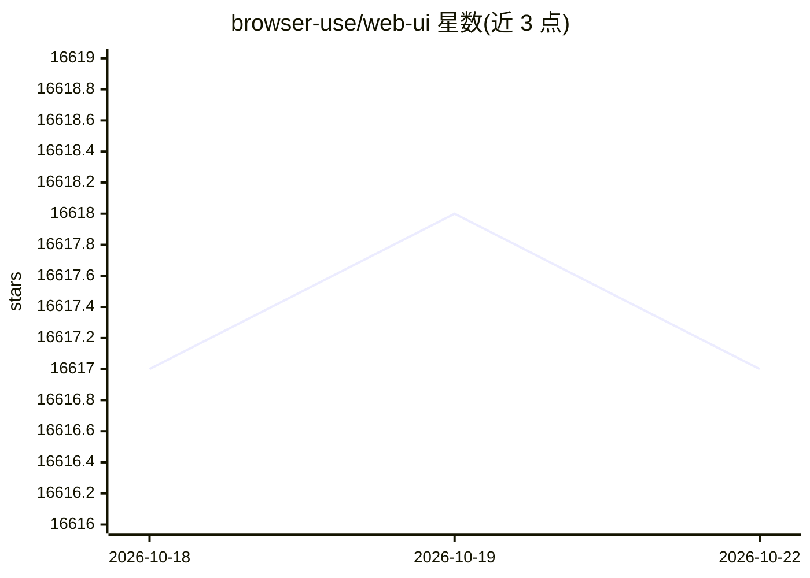

# browser-use/web-ui

⭐ 16,619 · Python · MIT · 推送 2026-09-25 · [GitHub](https://github.com/browser-use/web-ui) · 组织维护

**基于 Gradio 的浏览器 AI Agent Web 界面**

在 browser-use 基础上构建的 Web UI，通过 Gradio 提供对浏览器 agent 功能的图形化操作界面。集成多家 LLM 提供商，支持使用用户自有浏览器（复用登录态与认证），支持在任务间保持浏览器会话以保留完整交互历史，并提供高清屏幕录制。提供本地 Python（uv）与 Docker 两种安装方式，Docker 部署附带 VNC 以查看浏览器操作过程，支持 ARM64 平台。

## 筛选速览

| 维度 | 判定 | 备注 |
|---|---|---|
| AI 角色 | `ai-native` | 本体是模型或模型工具 |
| 许可风险 | `permissive` | MIT |
| 部署形态 | `desktop` | 安装包/桌面程序 |
| 模型依赖 | local-ok | 支持本地模型 |
| 硬件要求 | — | 无带数字的原话,不猜 |
| 安装摩擦 | `low` | 无编译、无系统依赖或容器化 |
| 成熟度 | — | 结构信号不足 |

## 动量与使用信号

- 维护:`active` — 距上次 push 23.2 天,年发版 0,54 位贡献者
- 涨星:近 1 天 **+2**(自 20261016 起算)
- 安装:github 包 `release-assets` 月下载无数据
- 平台:WINDOWS / MACOS / LINUX / WEB · 协议:OLLAMA

## 能力要点

- 基于 Gradio 的 Web 界面，支持多数 browser-use 功能
- 集成多家 LLM：Google、OpenAI、Azure OpenAI、Anthropic、DeepSeek、Ollama 等
- 支持使用自有浏览器，复用登录态并支持高清录屏
- Docker 部署附 VNC 观看浏览器交互，支持 ARM64

## 适用场景

- 通过图形界面运行浏览器自动化 AI 任务
- 复用本地 Chrome 登录态执行需认证的站点操作
- 通过 VNC 观看 agent 的浏览器操作过程

## 场景标签

`浏览器自动化` · 领域:效率与自动化

## 证据(README 行号)

> L8: This project builds upon the foundation of the browser-use, which is designed to make websites accessible for AI age
> L12: **WebUI:** is built on Gradio and supports most of `browser-use` functionalities. This UI is designed to be user-fr
> L14: **Expanded LLM Support:** We've integrated support for various Large Language Models (LLMs), including: Google, Ope

## 星数曲线

2026-10-18 16,617 → 2026-10-22 16,617（+0）

---
*卡片 v1 · prompt 1.4 · 生成 2026-10-18 · 置信度 mid · 依据 README sha `9f870456d565` · [字段定义](../../DATASET.md)*
