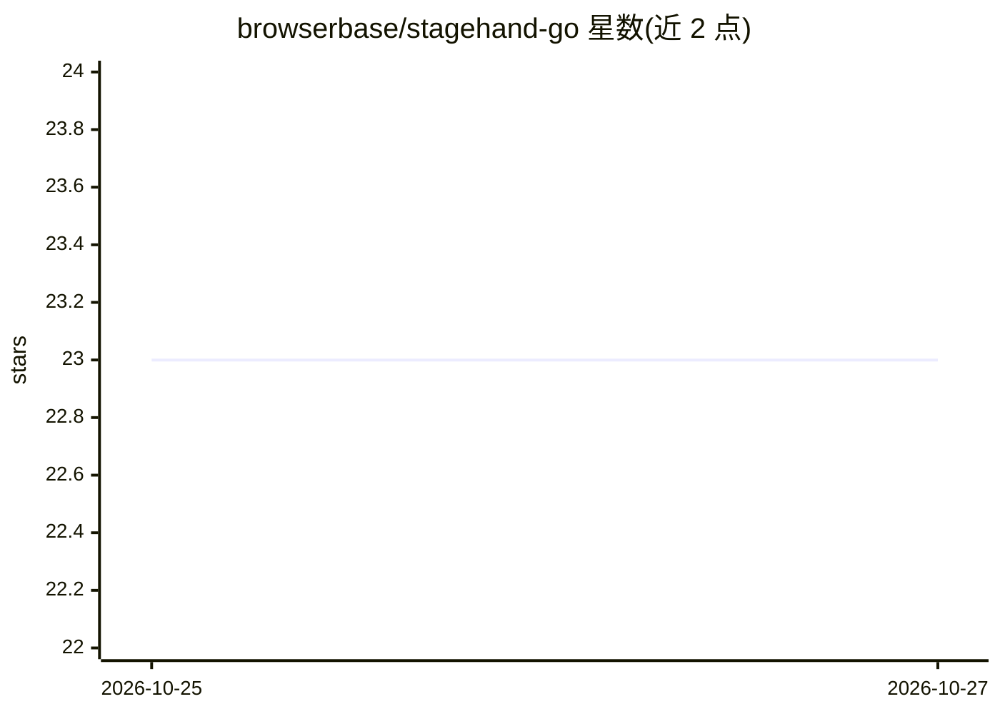

# browserbase/stagehand-go

⭐ 23 · Go · MIT · 推送 2026-10-23 · [GitHub](https://github.com/browserbase/stagehand-go) · [官网](https://stagehand.stldocs.app/api/go) · 组织维护

**Stagehand AI 浏览器自动化框架的官方 Go SDK**

Browserbase 官方维护的 Go 语言 API 库，封装 Stagehand 托管 API：Stagehand 是用自然语言与代码混合控制浏览器的自动化框架，支持 AI 动作预览、动作缓存与自愈以减少 LLM 调用。SDK 提供会话启动、模型选择、分页、自动重试（默认 2 次指数退避）、文件上传、中间件及未公开端点/参数访问等能力，需 Go 1.22+，通过 MODEL_API_KEY 与 BROWSERBASE_API_KEY 环境变量认证，含多个 chromedp 示例工程。

## 筛选速览

| 维度 | 判定 | 备注 |
|---|---|---|
| AI 角色 | `ai-ecosystem` | LLM/agent 周边工具 |
| 许可风险 | `permissive` | MIT |
| 部署形态 | `None` |  |
| 模型依赖 | — | README 未给出锁定关系 |
| 硬件要求 | — | 无带数字的原话,不猜 |
| 安装摩擦 | `low` | 无编译、无系统依赖或容器化 |
| 成熟度 | — | 结构信号不足 |

## 能力要点

- 封装 Stagehand 托管 API 的类型化 Go 客户端
- 自动重试（408/409/429/5xx）与可配置超时
- 支持未公开端点、参数与响应字段访问（SetExtraFields/RawJSON）
- 提供 chromedp 本地/远程浏览器与多区域示例工程

## 适用场景

- 在 Go 项目中接入 Stagehand 构建自然语言+代码混合的浏览器自动化
- 管理 Browserbase 托管浏览器会话
- 需要调用 SDK 未覆盖的 Stagehand API 端点时自行扩展请求

## 场景标签

`浏览器自动化` · 领域:效率与自动化

## 证据(README 行号)

> L36: Stagehand is a browser automation framework used to control web browsers with natural language and code. By combini
> L48: # Stagehand Go API Library

## 星数曲线

2026-10-25 23 → 2026-10-27 23（+0）

---
*卡片 v1 · prompt 1.4 · 生成 2026-10-27 · 置信度 high · 依据 README sha `85c23f30dbda` · [字段定义](../../DATASET.md)*
