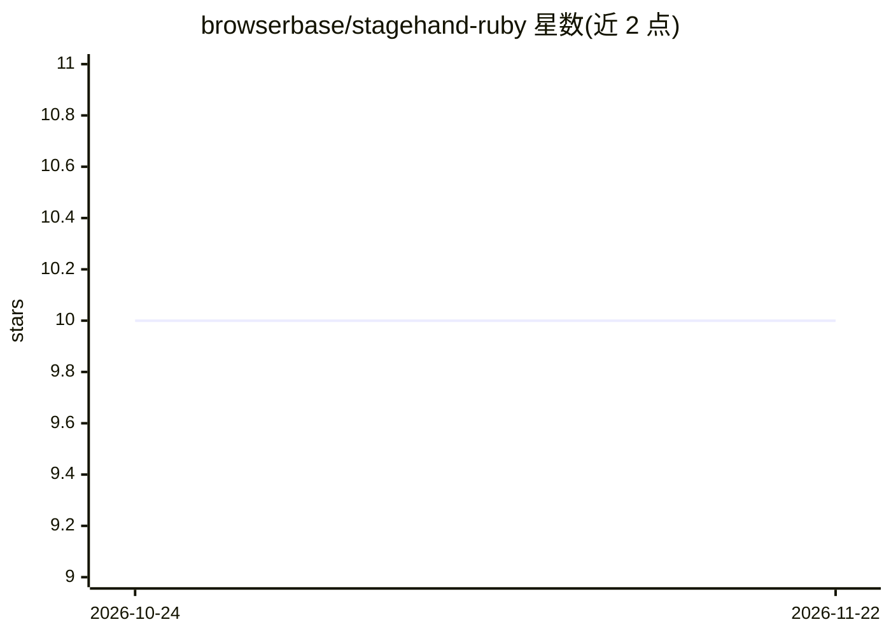

# browserbase/stagehand-ruby

⭐ 10 · Ruby · MIT · 推送 2026-10-23 · [GitHub](https://github.com/browserbase/stagehand-ruby) · [官网](https://docs.stagehand.dev/v3/sdk/ruby) · 组织维护

**给 Ruby 开发者接入 Stagehand AI 浏览器自动化 API 的 SDK**

Browserbase 官方维护的 Ruby 3.2.0+ 库，通过 REST API 访问 Stagehand AI 浏览器自动化框架。提供 Yard/RBS/RBI 类型定义与 Sorbet 支持，使用 net/http 传输并带连接池；内置 SSE 流式响应、按错误类别的自动重试（默认 2 次、指数退避）、60 秒超时配置与线程/连接池管理。提供本地与远程浏览器、Playwright 与 Watir 多种示例；模型调用需 MODEL_API_KEY，远程浏览器需 BROWSERBASE_API_KEY。

## 筛选速览

| 维度 | 判定 | 备注 |
|---|---|---|
| AI 角色 | `ai-ecosystem` | LLM/agent 周边工具 |
| 许可风险 | `permissive` | MIT |
| 部署形态 | `None` |  |
| 模型依赖 | — | README 未给出锁定关系 |
| 硬件要求 | — | 无带数字的原话,不猜 |
| 安装摩擦 | `low` | 无编译、无系统依赖或容器化 |
| 成熟度 | `idea` | |

## 能力要点

- Ruby 3.2.0+ 的 Stagehand REST API 客户端，Stainless 生成
- SSE 流式响应与自动重试/超时可配置
- 提供 Yard、RBS、RBI 类型定义与 Sorbet 支持
- 附带本地/远程浏览器、Playwright、Watir 示例

## 适用场景

- 在 Ruby 应用中用自然语言指令驱动浏览器操作
- 接入 Browserbase 远程浏览器会话执行自动化任务
- 需要类型安全与流式输出的 Ruby 自动化项目

## 场景标签

`浏览器自动化` · 领域:效率与自动化

## 证据(README 行号)

> L9:  The AI Browser Automation Framework
> L36: The Stagehand Ruby library provides convenient access to the Stagehand REST API from any Ruby 3.2.0+ application. I

## 星数曲线

2026-10-24 10 → 2026-11-22 10（+0）

---
*卡片 v1 · prompt 1.4 · 生成 2026-11-19 · 置信度 high · 依据 README sha `d213e7ef0b74` · [字段定义](../../DATASET.md)*
