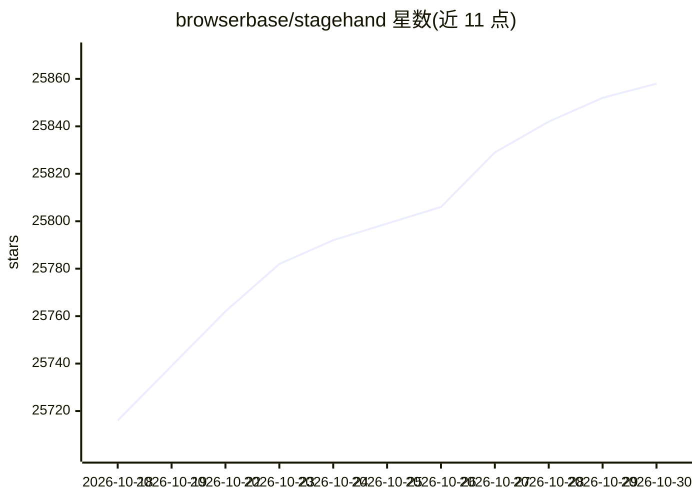

# browserbase/stagehand

⭐ 25,858 · TypeScript · MIT · 推送 2026-10-29 · [GitHub](https://github.com/browserbase/stagehand) · [官网](https://stagehand.dev) · 组织维护

**面向 agent 开发者的浏览器自动化 SDK：浏览、操作并提取网页数据**

以 SDK 形式提供的浏览器代理工具库，提供 goto/click/locator/screenshot 等 Playwright 风格 API，并以自然语言驱动 act/observe/extract 三类操作与数据抽取；支持通过无障碍树裁剪控制 token 用量，站点变更时自愈刷新动作。提供 TypeScript、Python、Go 三种 SDK，可本地运行（需安装 Chrome），也可指向 Browserbase 云端运行并配置 Model Gateway 接入模型；另提供托管 MCP server、Search/Fetch 接口与多框架集成。MIT 协议。

## 筛选速览

| 维度 | 判定 | 备注 |
|---|---|---|
| AI 角色 | `ai-native` | 本体是模型或模型工具 |
| 许可风险 | `permissive` | MIT |
| 部署形态 | `library` | 以包/库形式分发 |
| 模型依赖 | — | README 未给出锁定关系 |
| 硬件要求 | — | 无带数字的原话,不猜 |
| 安装摩擦 | `low` | 无编译、无系统依赖或容器化 |
| 成熟度 | — | 结构信号不足 |

## 动量与使用信号

- 维护:`active` — 距上次 push 1.6 天,年发版 49,47 位贡献者
- 涨星:近 1 天 **+21**(自 20261016 起算)
- 安装:pypi 包 `stagehand` 月下载 1,271,610
- 平台:— · 协议:MCP

## 能力要点

- Playwright 风格 API（goto/click/locator/screenshot）加自然语言 act/observe/extract
- TypeScript、Python、Go 三语言 SDK
- 托管 MCP server 可供 Claude Code、Cursor、Codex 等 MCP 客户端使用
- Search/Fetch 支持无浏览器的网页搜索与 URL 转 markdown

## 适用场景

- 让 agent 自动浏览网页并抽取结构化数据
- 为编码 agent（Claude Code/Cursor/Codex）接入浏览器能力
- 将现有 Playwright 测试套件迁移到 agent 化自动化
- 无需启动浏览器的网页抓取与搜索

## 场景标签

`浏览器自动化` `网页抓取` · 领域:效率与自动化

## 证据(README 行号)

> L7:  Stagehand is the SDK for browser agents
> L100:  One complete browser driver across TypeScript, Python, and Go.
> L135: The hosted Browserbase MCP server puts `navigate`, `act`, `observe`, and `extract` in any MCP client — no install,

## 星数曲线

2026-10-18 25,716 → 2026-10-30 25,858（+142）

---
*卡片 v1 · prompt 1.4 · 生成 2026-10-18 · 置信度 high · 依据 README sha `ec7a1a4bd0ec` · [字段定义](../../DATASET.md)*
