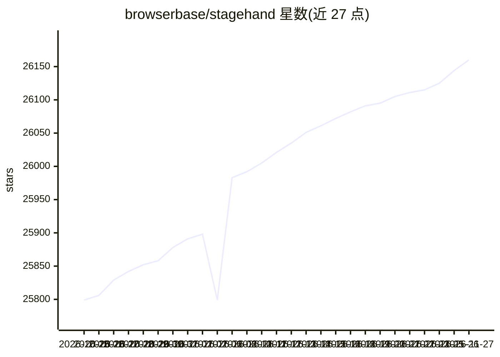

# browserbase/stagehand

⭐ 26,160 · TypeScript · MIT · 推送 2026-11-26 · [GitHub](https://github.com/browserbase/stagehand) · [官网](https://stagehand.dev) · 组织维护

**浏览器自动化 SDK：让 agent 像人一样操作网页并提取结构化数据**

面向开发者提供 TypeScript、Python、Go 三种语言的浏览器驱动 SDK，核心 API 为 act、observe、extract、search、fetch，以自然语言驱动浏览器动作与数据提取，并提供 Playwright 风格方法（goto、click、locator）。本地运行需安装 Chrome，无需 LLM key 或 Browserbase 账号；也可接入 Browserbase 云浏览器获得服务端缓存、会话录制、住宅代理等能力，并提供托管 MCP 服务器供 Claude Code、Cursor 等 MCP 客户端使用，另可安装 browse CLI 供编程型 agent 调用。

## 筛选速览

| 维度 | 判定 | 备注 |
|---|---|---|
| AI 角色 | `ai-ecosystem` | LLM/agent 周边工具 |
| 许可风险 | `permissive` | MIT |
| 部署形态 | `library` | 以包/库形式分发 |
| 模型依赖 | — | README 未给出锁定关系 |
| 硬件要求 | — | 无带数字的原话,不猜 |
| 安装摩擦 | `low` | 无编译、无系统依赖或容器化 |
| 成熟度 | — | 结构信号不足 |

## 动量与使用信号

- 维护:`active` — 距上次 push 1.6 天,年发版 49,47 位贡献者
- 涨星:近 1 天 **+21**(自 20261016 起算)
- 安装:pypi 包 `stagehand` 月下载 1,271,610
- 平台:— · 协议:MCP

## 能力要点

- TypeScript、Python、Go 三语言 SDK，统一浏览器驱动 API
- act/observe/extract 支持自然语言浏览器动作与数据提取，站点变化时自刷新动作方式
- 本地运行无需 LLM key 与 Browserbase 账号；托管 MCP 服务器免安装提供浏览器工具
- 混合可访问性树裁剪减少输入给 agent 的页面上下文

## 适用场景

- 为 AI agent 提供可复用的浏览器操作与数据提取能力
- 从需要登录的网站拉取结构化数据
- 给 Claude Code/Cursor 等客户端接入浏览器工具（MCP）
- 从 Playwright 迁移既有自动化套件

## 场景标签

`浏览器自动化` `网页抓取` · 领域:效率与自动化

## 证据(README 行号)

> L7:  Stagehand is the SDK for browser agents
> L94: No LLM key or Browserbase account needed for local use. See CLI vs SDK vs hosted MCP for when to use each.
> L118: Point the same script at Browserbase and get 2x faster execution than Playwright cloud equivalent browsers. Config

## 星数曲线

2026-10-25 25,799 → 2026-11-27 26,160（+361）

---
*卡片 v1 · prompt 1.4 · 生成 2026-11-22 · 置信度 high · 依据 README sha `012c7c0381eb` · [字段定义](../../DATASET.md)*
