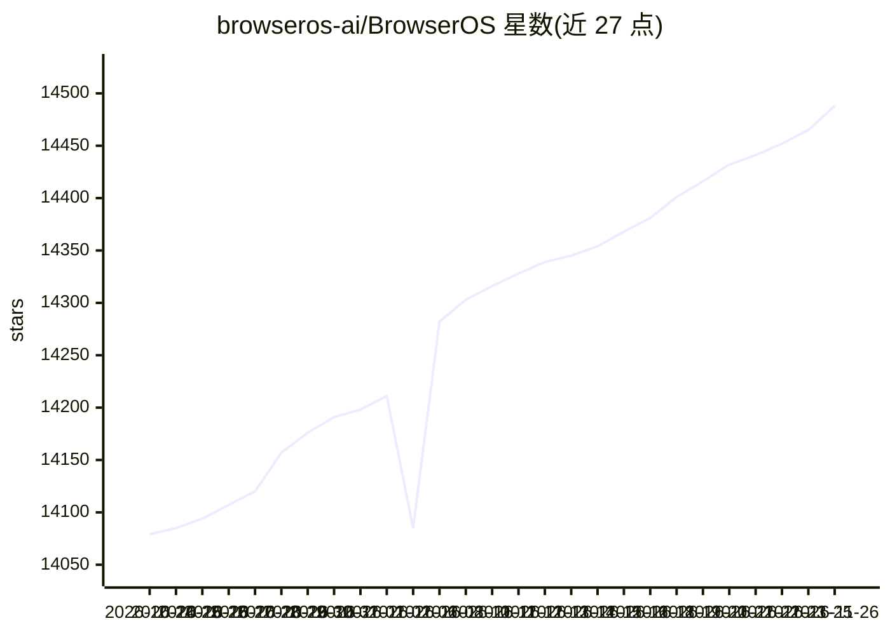

# browseros-ai/BrowserOS

⭐ 14,488 · Rust · AGPL-3.0 · 推送 2026-11-25 · [GitHub](https://github.com/browseros-ai/BrowserOS) · [官网](https://BrowserOS.com) · 组织维护

**面向 AI agent 的开源 Chromium 浏览器：让 agent 用你的登录身份干活**

基于 Chromium fork 的桌面浏览器，设计目标是在本机承载编码 agent（Claude Code、Codex、Cursor 等）执行浏览类任务：agent 以用户真实登录会话操作网页，各自拥有独立标签组，用户可实时观看或回放会话。页面内容以短文本而非截图形式提供给 agent 以减少 token 消耗；会话、截图与历史保存在本地。支持任何讲 MCP 的 agent 一键接入，浏览器扩展与书签可从 Chrome 一键导入。提供 macOS/Windows/Linux 安装包；修改浏览器内核源码约需 100 GB 磁盘。

## 筛选速览

| 维度 | 判定 | 备注 |
|---|---|---|
| AI 角色 | `ai-ecosystem` | LLM/agent 周边工具 |
| 许可风险 | `viral` | AGPL-3.0 |
| 部署形态 | `None` |  |
| 模型依赖 | — | README 未给出锁定关系 |
| 硬件要求 | — | 无带数字的原话,不猜 |
| 安装摩擦 | `low` | 无编译、无系统依赖或容器化 |
| 成熟度 | — | 结构信号不足 |

## 动量与使用信号

- 维护:`active` — 距上次 push 1.5 天,年发版 100,21 位贡献者
- 涨星:近 1 天 **+22**(自 20261016 起算)
- 下载:GitHub Release 附件 累计 15,494(100 个 release)
- 平台:WINDOWS / MACOS / LINUX · 协议:MCP / OLLAMA

## 能力要点

- agent 以用户真实登录身份操作网页，各 agent 拥有独立标签组可并行运行
- 兼容任何 MCP 协议的 agent，Claude Code/Codex/Cursor 等一键接入
- 页面以短文本而非截图读取以减少 token 消耗
- 会话与历史数据保留在本机，支持会话回放与登录卡点的用户接管

## 适用场景

- 让编码 agent 代我订机票、比价并完成网页操作
- agent 登录我的 Salesforce/Brex 账号做销售线索整理与账单核对
- 在保留 Chrome 扩展和登录态的前提下让多个 agent 并行浏览

## 场景标签

`浏览器自动化` · 领域:效率与自动化

## 证据(README 行号)

> L1: BrowserOS neo: a browser for your agents to do your chores.
> L43: How BrowserOS neo works: it connects to your LLM apps, runs many agents side by side, keeps your data on your compu
> L76: Any agent that speaks MCP. Claude Code, Codex, Cursor, OpenCode, Antigravity, VS Code and Zed connect in one click.

## 星数曲线

2026-10-24 14,079 → 2026-11-26 14,488（+409）

---
*卡片 v1 · prompt 1.4 · 生成 2026-11-26 · 置信度 high · 依据 README sha `a58b97f8278a` · [字段定义](../../DATASET.md)*
