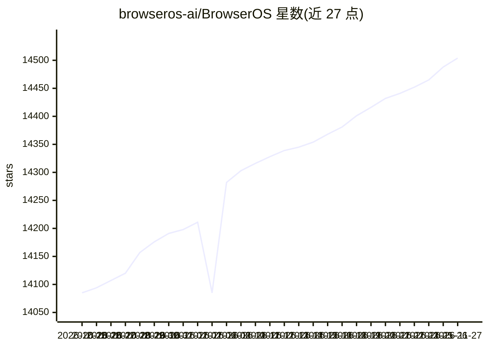

# browseros-ai/BrowserOS

⭐ 14,504 · Rust · AGPL-3.0 · 推送 2026-11-26 · [GitHub](https://github.com/browseros-ai/BrowserOS) · [官网](https://BrowserOS.com) · 组织维护

**为已有 coding agent 提供登录会话浏览器的 Chromium 分支**

BrowserOS neo 是一个基于 Chromium 的浏览器分支（AGPL-3.0），设计目标是被用户已有的 MCP 兼容 agent（如 Claude Code、Codex、Cursor、VS Code 等）驱动来执行真实网页任务。关键机制：自动发现并连接本机 agent，agent 在独立标签组中以用户已登录会话操作，遇到登录等需人工介入时通知用户交接；页面以短文本而非截图形式读取以减少 token；会话、截图与历史保存在本地。提供 macOS/Windows 安装包与 Linux AppImage/DEB，亦可经 Homebrew 安装；浏览器本体源码构建约需 100 GB 磁盘。

## 筛选速览

| 维度 | 判定 | 备注 |
|---|---|---|
| AI 角色 | `ai-enhanced` | 去掉 AI 部分产品仍成立 |
| 许可风险 | `viral` | AGPL-3.0 |
| 部署形态 | `None` |  |
| 模型依赖 | — | README 未给出锁定关系 |
| 硬件要求 | — | 无带数字的原话,不猜 |
| 安装摩擦 | `low` | 无编译、无系统依赖或容器化 |
| 成熟度 | — | 结构信号不足 |

## 动量与使用信号

- 维护:`active` — 距上次 push 1.5 天,年发版 100,21 位贡献者
- 涨星:近 1 天 **+22**(自 20261016 起算)
- 下载:GitHub Release 附件 累计 15,494(100 个 release)
- 平台:WINDOWS / MACOS / LINUX · 协议:MCP / OLLAMA

## 能力要点

- 自动发现并连接本机 MCP 兼容 agent（Claude Code、Codex、Cursor、VS Code、Zed 等）
- agent 使用用户已登录会话操作，每个 agent 拥有独立标签组，可并行运行
- 页面以短文本而非截图形式读取，会话数据保留在本地磁盘
- 提供 Chrome 登录信息、书签与扩展的一键导入

## 适用场景

- 让已有 coding agent 代为完成需要登录的网页操作（订票、比价、复制线索）
- 在 Salesforce/Brex 等业务系统中执行销售线索整理与账单核对
- 并行运行多个 agent 执行研究与部署类任务，同时保留自己的浏览器标签

## 场景标签

`浏览器自动化` · 领域:效率与自动化

## 证据(README 行号)

> L1: BrowserOS neo: a browser for your agents to do your chores.
> L4: Put Claude Code, Codex, Cursor, and OpenCode to work on your real tasks. BrowserOS neo connects to the agents you al
> L87: Yes. neo is a Chromium fork, so extensions work, and bookmarks, passwords and settings import in one click.

## 星数曲线

2026-10-25 14,085 → 2026-11-27 14,504（+419）

---
*卡片 v1 · prompt 1.4 · 生成 2026-11-27 · 置信度 high · 依据 README sha `b7b63f1428cb` · [字段定义](../../DATASET.md)*
