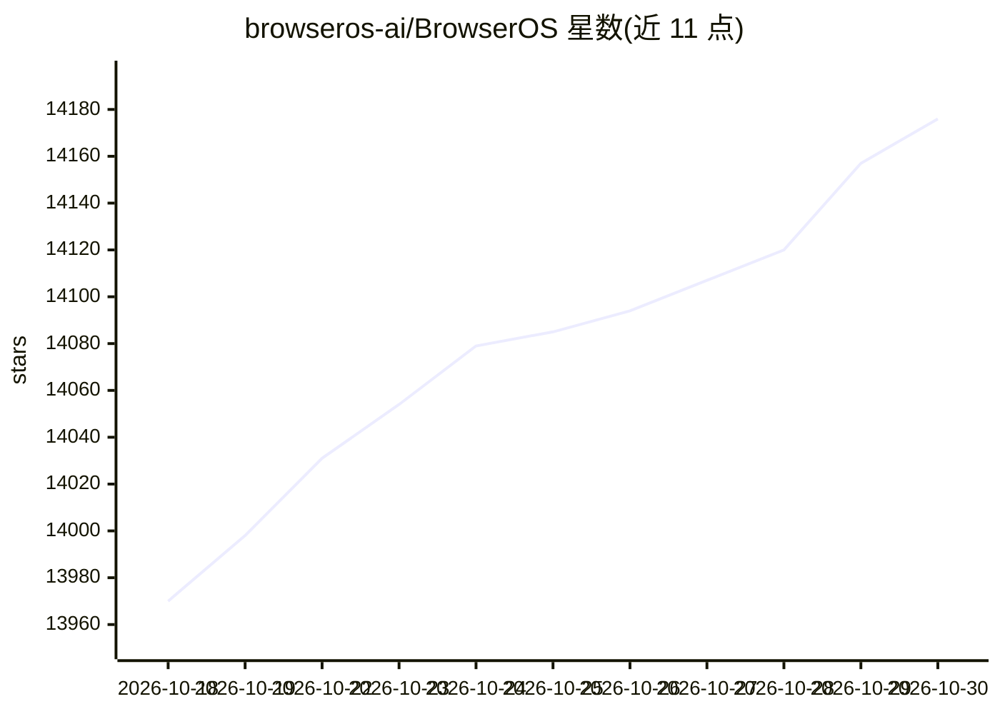

# browseros-ai/BrowserOS

⭐ 14,176 · TypeScript · AGPL-3.0 · 推送 2026-10-29 · [GitHub](https://github.com/browseros-ai/BrowserOS) · [官网](https://BrowserOS.com) · 组织维护

**给 AI agent 用的第二浏览器：代理执行登录态网页任务**

一个面向 AI agent 的浏览器：从 Chrome 一键导入登录态、书签与扩展，连接 Claude Code、Codex、Cursor 等任意 MCP 协议的 agent，让 agent 在独立标签页并行执行网页任务；提供实时仪表盘、会话录像回放（含动作时间线）与本地存储（~/.browserclaw/）。基于 Chromium fork，数据不出本机。与内置 AI 的 BrowserOS 由同一 monorepo 发布。AGPL-3.0 许可。

## 筛选速览

| 维度 | 判定 | 备注 |
|---|---|---|
| AI 角色 | `ai-native` | 本体是模型或模型工具 |
| 许可风险 | `viral` | AGPL-3.0 |
| 部署形态 | `None` |  |
| 模型依赖 | — | README 未给出锁定关系 |
| 硬件要求 | — | 无带数字的原话,不猜 |
| 安装摩擦 | `low` | 无编译、无系统依赖或容器化 |
| 成熟度 | — | 结构信号不足 |

## 动量与使用信号

- 维护:`active` — 距上次 push 1.5 天,年发版 100,21 位贡献者
- 涨星:近 1 天 **+22**(自 20261016 起算)
- 下载:GitHub Release 附件 累计 15,494(100 个 release)
- 平台:WINDOWS / MACOS / LINUX · 协议:MCP / OLLAMA

## 能力要点

- 一键连接 Claude Code、Codex、Cursor、VS Code 等支持 MCP 的 agent
- 从 Chrome 一键导入登录态，agent 以真实账号执行任务
- 会话保存为可拖动回放的视频并附动作时间线
- 会话、截图、历史本地存储，数据不上传

## 适用场景

- 让 agent 用我的登录账号订机票、发社媒、清理收件箱
- 并行给多个 agent 派发网页任务并回放审查操作过程
- 需要登录态的浏览器自动化而非 CI 无头场景

## 场景标签

`浏览器自动化` · 领域:浏览器/AI 基础设施

## 证据(README 行号)

> L21: A second browser, just for your AI agents. Import your logins from Chrome in one click, connect Claude Code, Codex,
> L86: - **Not a locked-in AI browser.** Atlas, Comet, and Dia only work with their own AI. BrowserOS neo works with the a
> L121: Both browsers ship from this monorepo. Two main subsystems: the **browser** (Chromium fork, C++ and Python) and th

## 星数曲线

2026-10-18 13,970 → 2026-10-30 14,176（+206）

---
*卡片 v1 · prompt 1.4 · 生成 2026-10-18 · 置信度 high · 依据 README sha `3170d3c173e3` · [字段定义](../../DATASET.md)*
