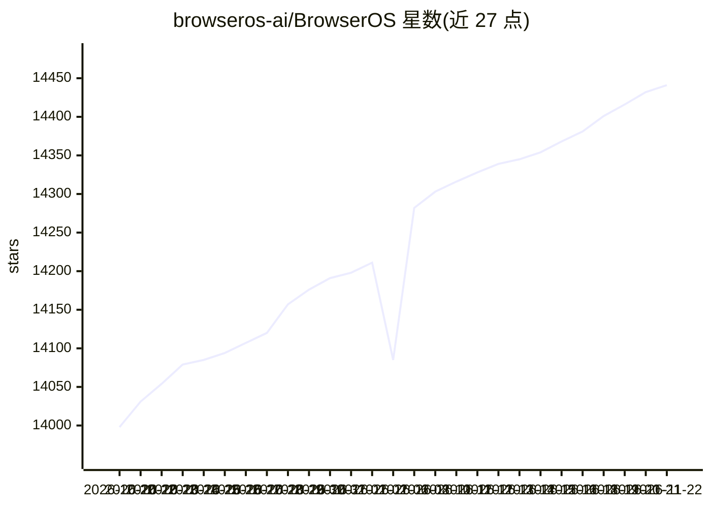

# browseros-ai/BrowserOS

⭐ 14,441 · Rust · AGPL-3.0 · 推送 2026-11-21 · [GitHub](https://github.com/browseros-ai/BrowserOS) · [官网](https://BrowserOS.com) · 组织维护

**开源 agentic 浏览器：让 AI agent 用真实登录态执行网页任务**

基于 Chromium fork 的第二浏览器，定位为给 AI agent 使用而非替代 Chrome：一键导入 Chrome 登录态、书签与扩展，通过 MCP 连接本机的 Claude Code、Codex、Cursor 等代理工具，代理在各自标签页并行执行网页任务。提供实时任务面板、会话录像回放与操作时间线，数据本地存储于 ~/.browserclaw/，支持 macOS/Windows/Linux 安装包。README 明确其非无头驱动器、非云浏览器路线，使用 AGPL-3.0 许可。

## 筛选速览

| 维度 | 判定 | 备注 |
|---|---|---|
| AI 角色 | `ai-ecosystem` | LLM/agent 周边工具 |
| 许可风险 | `viral` | AGPL-3.0 |
| 部署形态 | `None` |  |
| 模型依赖 | — | README 未给出锁定关系 |
| 硬件要求 | — | 无带数字的原话,不猜 |
| 安装摩擦 | `low` | 无编译、无系统依赖或容器化 |
| 成熟度 | — | 结构信号不足 |

## 动量与使用信号

- 维护:`active` — 距上次 push 1.5 天,年发版 100,21 位贡献者
- 涨星:近 1 天 **+22**(自 20261016 起算)
- 下载:GitHub Release 附件 累计 15,494(100 个 release)
- 平台:WINDOWS / MACOS / LINUX · 协议:MCP / OLLAMA

## 能力要点

- 通过 MCP 一键连接本机任意 agent 工具（Claude Code、Codex、Cursor、VS Code、Zed 等）
- 一键导入 Chrome 登录态，agent 以真实账号执行任务
- 并行 agent 各自独立标签页运行，附实时面板与会话录像回放
- 本地运行、数据不出本机（可关闭匿名遥测）

## 适用场景

- 让 agent 在我已登录的账号下订机票、发社媒、清理邮箱
- 在真实浏览器环境中并行跑多个 agent 网页任务
- 回放录像核查 agent 每一步网页操作
- 维护一个专门供 agent 使用、与日常 Chrome 隔离的浏览器

## 场景标签

`浏览器自动化` · 领域:效率与自动化

## 证据(README 行号)

> L21: A second browser, just for your AI agents. Import your logins from Chrome in one click, connect Claude Code, Codex,
> L86: - **Not a locked-in AI browser.** Atlas, Comet, and Dia only work with their own AI. BrowserOS neo works with the a
> L97: Yes. BrowserOS neo is a Chromium fork, so Chrome extensions work and your bookmarks, passwords, and settings import

## 星数曲线

2026-10-20 13,998 → 2026-11-22 14,441（+443）

---
*卡片 v1 · prompt 1.4 · 生成 2026-11-22 · 置信度 high · 依据 README sha `a8cc02aa777d` · [字段定义](../../DATASET.md)*
