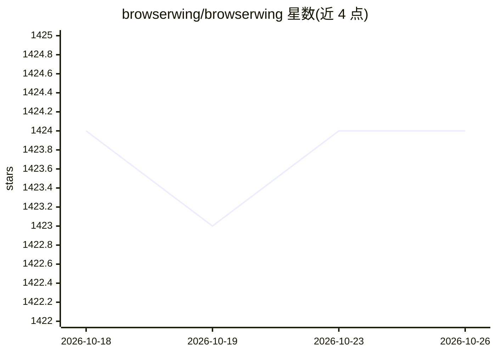

# browserwing/browserwing

⭐ 1,424 · Go · MIT · 推送 2026-08-08 · [GitHub](https://github.com/browserwing/browserwing) · [官网](https://www.browserwing.com) · 个人维护 · 中文 README

**浏览器自动化平台：把网站操作变成 MCP 命令与脚本供 AI agent 调用**

用 Go/React 构建的浏览器自动化平台，面向开发 AI agent 的开发者：提供 26+ HTTP API 端点、78 个内置脚本（覆盖 GitHub、Bilibili、YouTube 等 10 类站点）、CLI 与结构化退出码，支持 MCP server 与 Skills 协议接入各类 AI 工具，内置可对话操作的 AI Agent（可配 OpenAI/Claude/DeepSeek 等 LLM）。支持可视化录制浏览器操作并导出为 MCP 命令或 Skills 文件；可选配合 CloakBrowser 反检测浏览器。运行需本机装有 Chrome/Chromium。

## 筛选速览

| 维度 | 判定 | 备注 |
|---|---|---|
| AI 角色 | `ai-ecosystem` | LLM/agent 周边工具 |
| 许可风险 | `permissive` | MIT |
| 部署形态 | `desktop` | 安装包/桌面程序 |
| 模型依赖 | — | README 未给出锁定关系 |
| 硬件要求 | — | 无带数字的原话,不猜 |
| 安装摩擦 | `medium` | 含编译或系统依赖之一 |
| 成熟度 | — | 结构信号不足 |

## 能力要点

- 78 个内置脚本、10 类站点，CLI 输出结构化 JSON
- MCP server / Skills 文件 / 内置 AI Agent 三种接入方式
- 可视化录制浏览器操作并导出为 MCP 命令或 Skills 文件
- 26+ RESTful HTTP 端点覆盖导航、交互、数据提取

## 适用场景

- 让 AI agent 通过 MCP 或 CLI 抓取网站结构化数据
- 录制并复用浏览器操作脚本，导出给 AI 工具复用
- 以对话方式驱动浏览器完成自动化任务

## 场景标签

`浏览器自动化` `网页抓取` · 领域:效率与自动化

## 证据(README 行号)

> L17: > **Turn any website into structured data with one command.** Browser automation platform with 78 built-in scripts,
> L44: - **Universal AI Tool Integration**: Native MCP & Skills protocol support - compatible with any AI tool that suppor
> L155: ### 1. MCP Server Integration

## 星数曲线

2026-10-18 1,424 → 2026-10-26 1,424（+0）

---
*卡片 v1 · prompt 1.4 · 生成 2026-10-21 · 置信度 mid · 依据 README sha `30d743463a75` · [字段定义](../../DATASET.md)*
