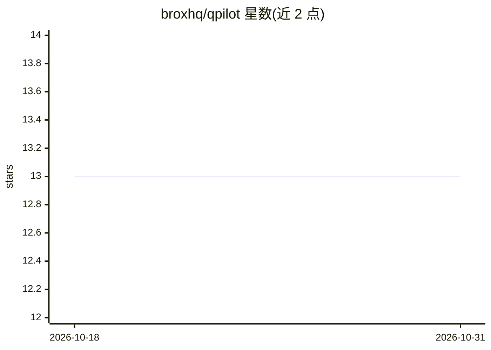

# broxhq/qpilot

⭐ 13 · TypeScript · MIT · 推送 2026-10-23 · [GitHub](https://github.com/broxhq/qpilot) · [官网](https://brox.sh/) · 组织维护

**AI agent：在真实浏览器中执行纯文本手工测试用例**

面向 QA 与测试人员的浏览器测试 agent：粘贴纯文本测试用例（无需代码、选择器或配置文件），agent 打开 Chrome 逐步执行，实时输出每步 pass/fail/warn 及引用页面证据与失败截图；遇到 OTP/验证码会暂停询问后继续。支持附件上传与 .md 文件夹批量运行。模型接入 Anthropic 或任意 OpenAI 兼容端点（需支持工具调用），本地运行，通过 npx qpilot 一键安装。需要 Node.js 20.12+ 与 Chrome。

## 筛选速览

| 维度 | 判定 | 备注 |
|---|---|---|
| AI 角色 | `ai-native` | 本体是模型或模型工具 |
| 许可风险 | `permissive` | MIT |
| 部署形态 | `library` | 以包/库形式分发 |
| 模型依赖 | local-ok | 支持本地模型 |
| 硬件要求 | — | 无带数字的原话,不猜 |
| 安装摩擦 | `low` | 无编译、无系统依赖或容器化 |
| 成熟度 | — | 结构信号不足 |

## 能力要点

- 纯文本测试用例驱动，无需测试代码与选择器
- 逐步实时 pass/fail/warn 判定，含页面证据与失败截图
- 遇 OTP/验证码暂停人工介入后继续
- 支持任意 OpenAI 兼容端点（Qwen/vLLM/Ollama 等），需工具调用能力

## 适用场景

- 把手写/Confluence 里的测试步骤变成可自动执行的浏览器测试
- 改版后无需维护选择器地重跑回归用例
- 对内网或 staging 环境做本地化测试执行

## 场景标签

`浏览器自动化` · 领域:效率与自动化

## 证据(README 行号)

> L3:  An AI agent that runs your manual test cases in a real browser.
> L21: — or any OpenAI-compatible endpoint (Qwen, vLLM, Ollama, a corporate gateway).

## 星数曲线

2026-10-18 13 → 2026-10-31 13（+0）

---
*卡片 v1 · prompt 1.4 · 生成 2026-10-31 · 置信度 high · 依据 README sha `a8a8bbcead85` · [字段定义](../../DATASET.md)*
