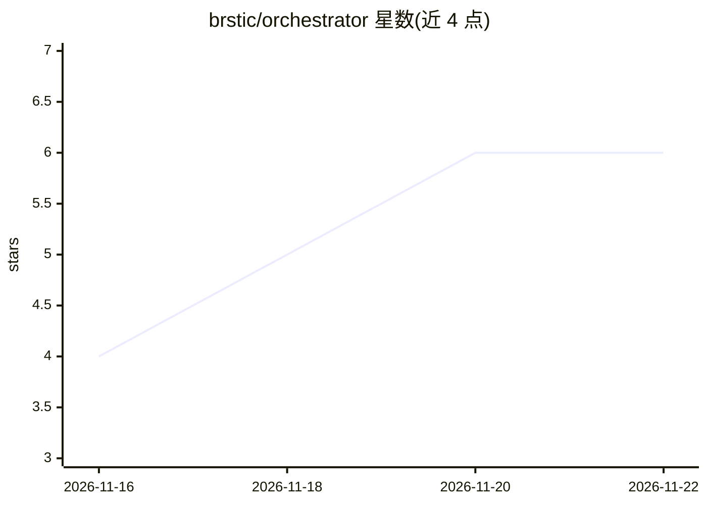

# brstic/orchestrator

⭐ 6 · TypeScript · Apache-2.0 · 推送 2026-11-20 · [GitHub](https://github.com/brstic/orchestrator) · [官网](https://office-demo.sparkcan.com) · 个人维护

**以 3D 办公室形式管理真实 Claude Code 会话的多代理协作工具**

将服务器上运行的真实 Claude Code 进程（tmux 会话、git worktree）可视化为 3D 办公室中的员工：用户以 WASD 行走，按 F 与代理对话、Space 接管其终端。完成状态由办公室实测（测试运行、同事评审、合并）而非代理自报。支持多人通过桌面应用或浏览器加入同一服务器，提供任务队列、权限应答、多 Claude 账户切换、定时例程与 Telegram 机器人。依赖 Node.js 22.18+、tmux、git 与已登录的 Claude Code CLI，以 pnpm 构建运行，Apache License 2.0。

## 筛选速览

| 维度 | 判定 | 备注 |
|---|---|---|
| AI 角色 | `ai-ecosystem` | LLM/agent 周边工具 |
| 许可风险 | `permissive` | Apache-2.0 |
| 部署形态 | `library` | 以包/库形式分发 |
| 模型依赖 | locked-api |  |
| 硬件要求 | — | 无带数字的原话,不猜 |
| 安装摩擦 | `low` | 无编译、无系统依赖或容器化 |
| 成熟度 | — | 结构信号不足 |

## 能力要点

- 每个员工对应一个真实 tmux 会话中的 claude 进程与 git worktree
- 完成判定由办公室实测：测试运行、评审、合并
- 单服务器多人协作，同事电脑可加入为独立房间
- 多 Claude 账户管理与配额用尽后自动迁移

## 适用场景

- 团队在共享服务器上运行多个 Claude Code 代理并统一管理
- 通过 3D 界面查看各代理会话状态并接管终端
- 给任务设置 worktree 分支并要求测试与评审后才算完成

## 场景标签

`编码 Agent` `多智能体` · 领域:Agent 开发

## 证据(README 行号)

> L11:  Live demo Built for Claude Code TypeScript Node.js 22.18 or newer React 19 three.js Electron 33 tmux macOS, Linux,
> L25:  Every person at a desk is a real <code>claude</code> process in a real tmux session, in a real git worktree, on a 
> L161: Requirements: **Node.js 22.18+**, **tmux**, **git**, the **Claude Code CLI** (`claude`) logged in, and pnpm.

## 星数曲线

2026-11-16 4 → 2026-11-22 6（+2）

---
*卡片 v1 · prompt 1.4 · 生成 2026-11-20 · 置信度 high · 依据 README sha `0a7c4636a5fb` · [字段定义](../../DATASET.md)*
