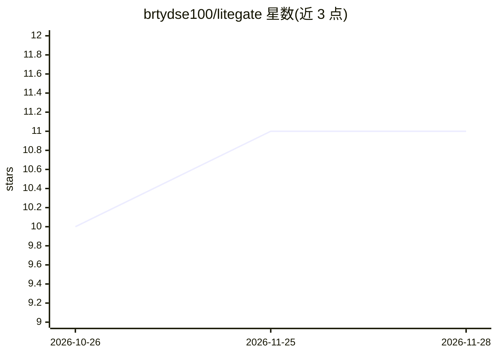

# brtydse100/litegate

⭐ 11 · Python · MIT · 推送 2026-11-26 · [GitHub](https://github.com/brtydse100/litegate) · [官网](https://brtydse100.github.io/litegate/) · 个人维护

**给组织自助发放管理 LiteLLM API 密钥的门户**

围绕 LiteLLM 的自助访问层门户与 API：普通用户经 SSO（OIDC）或本地账号登录，一键创建、查看、重新生成个人 LiteLLM 密钥，查看适用的模型、预算、花费与速率限制，无需接触管理员面板或主密钥；SSO 分组可自动映射到 LiteLLM 团队以继承预算与模型策略。另提供本地用户管理、团队策略、管理员批量改钥、自动化 API、审计、备份恢复等运维工具。要求已有一个可访问的 LiteLLM 实例及其主密钥，本身不替代 LiteLLM 的路由与计费职责。前端 React、后端 FastAPI，经 Docker Compose 或 Kubernetes/Helm 部署。

## 筛选速览

| 维度 | 判定 | 备注 |
|---|---|---|
| AI 角色 | `ai-ecosystem` | LLM/agent 周边工具 |
| 许可风险 | `permissive` | MIT |
| 部署形态 | `self-host` | docker 或自建部署 |
| 模型依赖 | — | README 未给出锁定关系 |
| 硬件要求 | — | 无带数字的原话,不猜 |
| 安装摩擦 | `low` | 无编译、无系统依赖或容器化 |
| 成熟度 | — | 结构信号不足 |

## 能力要点

- 用户一键自助创建/再生成个人密钥，管理员无需分发主密钥
- SSO 分组自动映射 LiteLLM 团队，继承预算与模型策略
- 管理员批量密钥编辑、自动化 API、审计与备份恢复工具
- OIDC 签名校验、PBKDF2 口令哈希、限速与冷却等安全机制

## 适用场景

- 给团队成员自助发放受预算和模型策略约束的 LLM 密钥
- 替代共享主密钥的内部 LLM 网关接入管理
- 通过自动化 API 把密钥开通流程接入企业工作流

## 场景标签

`模型网关` · 领域:Agent 开发

## 证据(README 行号)

> L5: LiteGate gives people one simple page to create and manage their own governed
> L53: LiteGate is an access layer, not a LiteLLM replacement. LiteLLM remains

## 星数曲线

2026-10-26 10 → 2026-11-28 11（+1）

---
*卡片 v1 · prompt 1.4 · 生成 2026-11-19 · 置信度 high · 依据 README sha `c052a6cd1813` · [字段定义](../../DATASET.md)*
