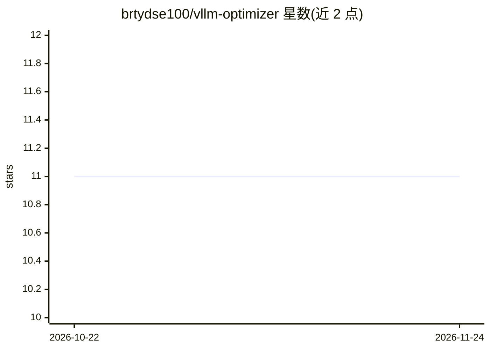

# brtydse100/vllm-optimizer

⭐ 11 · Python · MIT · 推送 2026-11-17 · [GitHub](https://github.com/brtydse100/vllm-optimizer) · [官网](https://brtydse100.github.io/vllm-optimizer/) · 个人维护

**面向 vLLM 用户的基准驱动服务配置自动寻优工具**

vLLM 是推理服务运行时，其服务参数组合对负载敏感；本工具让用户以 YAML 定义可调参数搜索空间（vLLM 启动标志与环境变量），自动运行 GuideLLM 或 vLLM Bench Serve 基准，支持 Grid/Random/TPE 搜索，按 p99 TTFT、吞吐等延迟/吞吐约束打分，输出含全部试验的交互式 HTML 报告。执行需 Python 3.11–3.12、Linux/WSL、NVIDIA GPU 与本地模型文件（不下载模型）。定位为独立社区 alpha 软件，非 vLLM 官方；L40/H100、tensor-parallel、多 GPU 场景的硬件验证标注为待完成。

## 筛选速览

| 维度 | 判定 | 备注 |
|---|---|---|
| AI 角色 | `ai-ecosystem` | LLM/agent 周边工具 |
| 许可风险 | `permissive` | MIT |
| 部署形态 | `library` | 以包/库形式分发 |
| 模型依赖 | local-ok | 支持本地模型 |
| 硬件要求 | — | 无带数字的原话,不猜 |
| 安装摩擦 | `medium` | 含编译或系统依赖之一 |
| 成熟度 | `idea` | |

## 能力要点

- YAML 定义搜索空间，自动运行基准并输出最佳观测配置
- 支持 Grid/Random/TPE 搜索与基线对比
- 支持 GuideLLM 或原生 vLLM Bench Serve 两种工作负载
- 交互式 HTML 报告展示吞吐、置信度与全部试验

## 适用场景

- 为特定负载寻找 vLLM 启动参数组合
- 在延迟约束下（如 p99 TTFT≤200ms）最大化吞吐
- 对配置试验结果做可复现的留存与对比

## 场景标签

 · 领域:LLM 基础设施/推理优化

## 证据(README 行号)

> L3: Find better vLLM serving settings for your workload. Define a search space in
> L10: This is independent community alpha software, not affiliated with vLLM.
> L11: Execution needs Python 3.11–3.12, Linux/WSL, an NVIDIA GPU, and a local model.

## 星数曲线

2026-10-22 11 → 2026-11-24 11（+0）

---
*卡片 v1 · prompt 1.4 · 生成 2026-11-18 · 置信度 high · 依据 README sha `fe366ac7a99d` · [字段定义](../../DATASET.md)*
