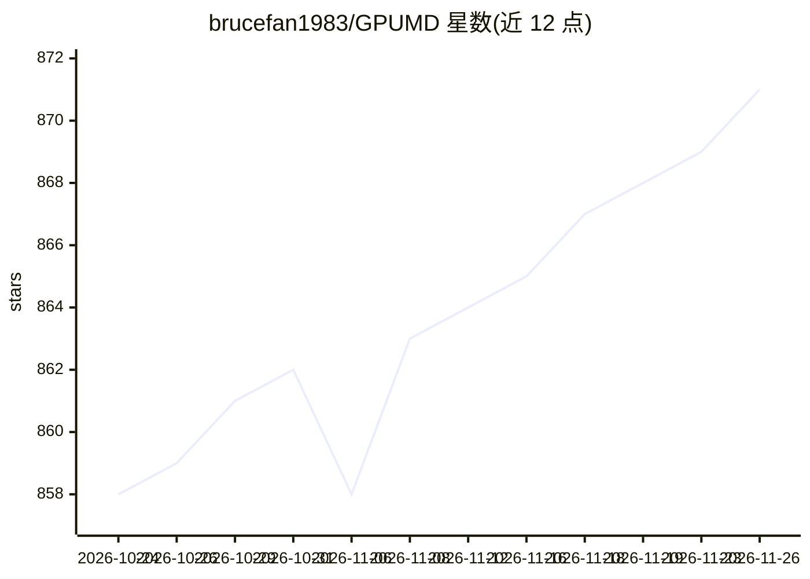

# brucefan1983/GPUMD

⭐ 871 · Cuda · 推送 2026-11-25 · [GitHub](https://github.com/brucefan1983/GPUMD) · [官网](https://gpumd.org/dev) · 组织维护

**GPU 上运行的通用分子动力学模拟科研软件包**

基于 CUDA 实现的通用分子动力学（MD）软件，含两个主程序：gpumd 执行经验势或 NEP（神经演化势）模型的分子动力学与静态计算，nep 负责 NEP 模型的训练与预测。应用覆盖热输运、热力学与力学性质、晶格动力学、冲击压缩、路径积分 MD 与粗粒化模拟。需自行从源码编译，要求 CUDA capable NVIDIA GPU、匹配的驱动、CUDA 工具链与主机编译器；另支持 CMake 构建与 ROCm/HIP 路线的 AMD GPU。

## 筛选速览

| 维度 | 判定 | 备注 |
|---|---|---|
| AI 角色 | `ai-native` | 本体是模型或模型工具 |
| 许可风险 | `none` | — |
| 部署形态 | `None` |  |
| 模型依赖 | — | README 未给出锁定关系 |
| 硬件要求 | — | 无带数字的原话,不猜 |
| 安装摩擦 | `high` | 编译与系统依赖俱全 |
| 成熟度 | — | 结构信号不足 |

## 能力要点

- gpumd/nep 双程序：分子动力学模拟与 NEP 机器学习势训练预测
- 支持经验势与神经演化势（NEP）模型
- 官方提供 Colab 教程与 nep-data 已发布模型/数据集仓库
- 支持多 GPU 执行与 AMD GPU（ROCm/HIP，经 CMake）

## 适用场景

- 计算材料的热输运与热导率等性质
- 用 train.xyz 数据集训练 NEP 机器学习势并用于模拟
- 冲击压缩、路径积分分子动力学等 MD 方法研究

## 场景标签

 · 领域:计算物理/材料模拟

## 证据(README 行号)

> L7: GPUMD is a high-performance, general-purpose molecular dynamics package implemented on GPUs. It supports empirical i
> L16: |`nep`|Training and prediction with NEP models.|`nep.in` and datasets such as `train.xyz`.|
> L24: For the NVIDIA/CUDA build, you need a CUDA-capable NVIDIA GPU, a compatible NVIDIA driver and CUDA toolkit, a suppo

## 星数曲线

2026-10-24 858 → 2026-11-26 871（+13）

---
*卡片 v1 · prompt 1.4 · 生成 2026-11-24 · 置信度 high · 依据 README sha `576c07afad47` · [字段定义](../../DATASET.md)*
