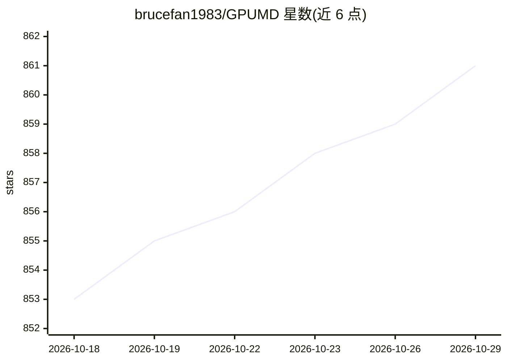

# brucefan1983/GPUMD

⭐ 861 · Cuda · 推送 2026-10-28 · [GitHub](https://github.com/brucefan1983/GPUMD) · [官网](https://gpumd.org/dev) · 组织维护

**面向材料模拟的 GPU 分子动力学软件包，含 NEP 机器学习势训练**

在 GPU 上实现的通用高性能分子动力学软件包，提供 gpumd（经验势与 NEP 模型的模拟及静态计算）和 nep（NEP 模型训练与预测）两个可执行程序。应用覆盖热输运、热力学与力学性质、晶格动力学、冲击压缩、路径积分分子动力学与粗粒化模拟。NEP 通过神经进化方法训练，已发布模型与数据存于 nep-data 仓库。构建需 CUDA-capable NVIDIA GPU 与 CUDA toolkit（CMake 构建支持 AMD ROCm/HIP），从源码编译；NEP_CPU 另以独立项目提供 CPU 上的 NEP 计算引擎并含 LAMMPS 接口。使用需引用相应论文。

## 筛选速览

| 维度 | 判定 | 备注 |
|---|---|---|
| AI 角色 | `ai-native` | 本体是模型或模型工具 |
| 许可风险 | `none` | — |
| 部署形态 | `None` |  |
| 模型依赖 | — | README 未给出锁定关系 |
| 硬件要求 | — | 无带数字的原话,不猜 |
| 安装摩擦 | `high` | 编译与系统依赖俱全 |
| 成熟度 | — | 结构信号不足 |

## 能力要点

- gpumd 与 nep 双可执行程序：模拟与 NEP 模型训练/预测
- 支持经验势与神经进化势（NEP），覆盖热输运、冲击压缩、PIMD 等
- 源码编译支持 NVIDIA CUDA 与 AMD ROCm/HIP，含多 GPU 执行说明
- NEP_CPU 独立项目提供 CPU 推理与 LAMMPS 接口

## 适用场景

- 运行大规模机器学习势分子动力学模拟
- 从数据集训练 NEP 势并预测材料性质
- 计算热导率等热输运与力学性质

## 场景标签

 · 领域:计算材料学/科学计算

## 证据(README 行号)

> L7: GPUMD is a high-performance, general-purpose molecular dynamics package implemented on GPUs. It supports empirical i
> L15: |`gpumd`|Molecular dynamics simulations and static calculations with empirical or NEP models.|`run.in`, `model.xyz`

## 星数曲线

2026-10-18 853 → 2026-10-29 861（+8）

---
*卡片 v1 · prompt 1.4 · 生成 2026-10-21 · 置信度 high · 依据 README sha `555315ccb509` · [字段定义](../../DATASET.md)*
