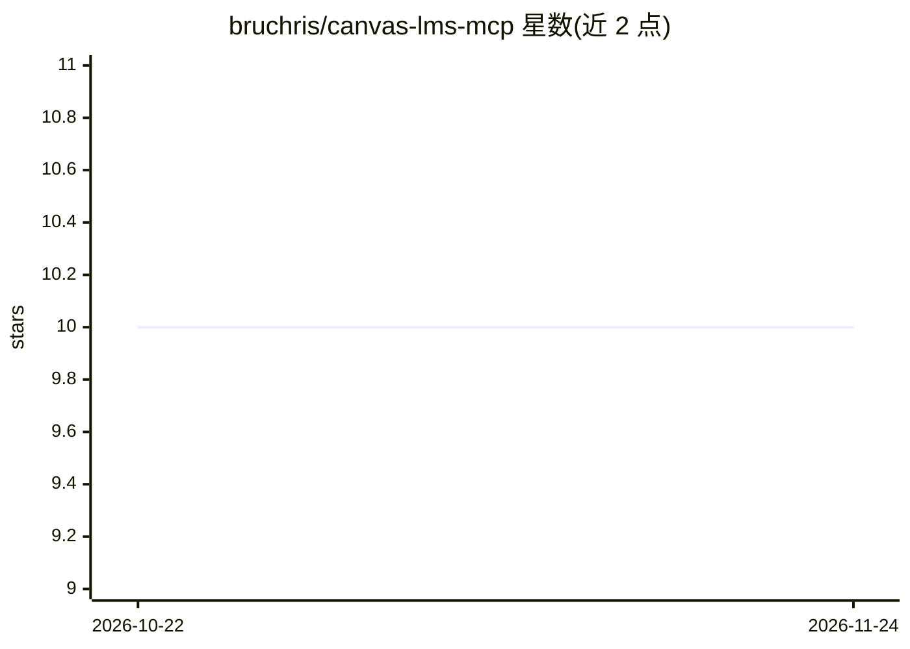

# bruchris/canvas-lms-mcp

⭐ 10 · TypeScript · MIT · 推送 2026-11-20 · [GitHub](https://github.com/bruchris/canvas-lms-mcp) · [官网](https://bruchris.github.io/canvas-lms-mcp/) · 个人维护

**让 AI agent 通过 MCP 读取和操作 Canvas LMS 的服务器**

TypeScript 实现的 Canvas LMS MCP 服务器，注册 187 个工具，覆盖课程、作业、提交、评分标准、测验、文件、用户、讨论、日历等资源的读取与写操作（125 只读/62 写入），并提供成绩册审计、学生风险识别等 17 个 Agent Skills 工作流。支持 stdio、HTTP 和库导入三种部署方式，提供面向 Claude Desktop 的 .mcpb 一键安装包及多客户端配置向导。写操作依赖 Canvas 自身权限模型，服务器不绕过；Canvas 按用户限流，批量操作需串行分批。

## 筛选速览

| 维度 | 判定 | 备注 |
|---|---|---|
| AI 角色 | `ai-ecosystem` | LLM/agent 周边工具 |
| 许可风险 | `permissive` | MIT |
| 部署形态 | `self-host` | docker 或自建部署 |
| 模型依赖 | — | README 未给出锁定关系 |
| 硬件要求 | — | 无带数字的原话,不猜 |
| 安装摩擦 | `low` | 无编译、无系统依赖或容器化 |
| 成熟度 | — | 结构信号不足 |

## 能力要点

- 187 个 MCP 工具覆盖 Canvas 课程/作业/成绩/测验/用户/分析等资源
- 17 个可安装的 Agent Skills 工作流，同时以 MCP prompts 形式提供
- FERPA 模式支持学生信息假名化（stdio 传输）
- 提供 Claude Desktop .mcpb 安装包、Cursor/VS Code 一键配置与客户端检测向导

## 适用场景

- 通过对话让 AI 查询课程、作业与成绩数据
- 教师在 AI 客户端中批改作业并添加评语
- 对学生成绩下滑或缺交作业情况进行检索与跟进
- 批量导出/迁移课程内容或生成测验题目

## 场景标签

 · 领域:教育/LMS 集成

## 证据(README 行号)

> L3: > The TypeScript MCP server for Canvas LMS.
> L12: MCP server for Canvas LMS. Read courses, assignments, submissions, rubrics, quizzes; grade, comment, manage course 
> L14: 187 tools across Canvas courses, assignments, submissions, gradebook history, rubrics, quizzes, New Quizzes (LTI), 

## 星数曲线

2026-10-22 10 → 2026-11-24 10（+0）

---
*卡片 v1 · prompt 1.4 · 生成 2026-11-19 · 置信度 mid · 依据 README sha `703f942b3a53` · [字段定义](../../DATASET.md)*
