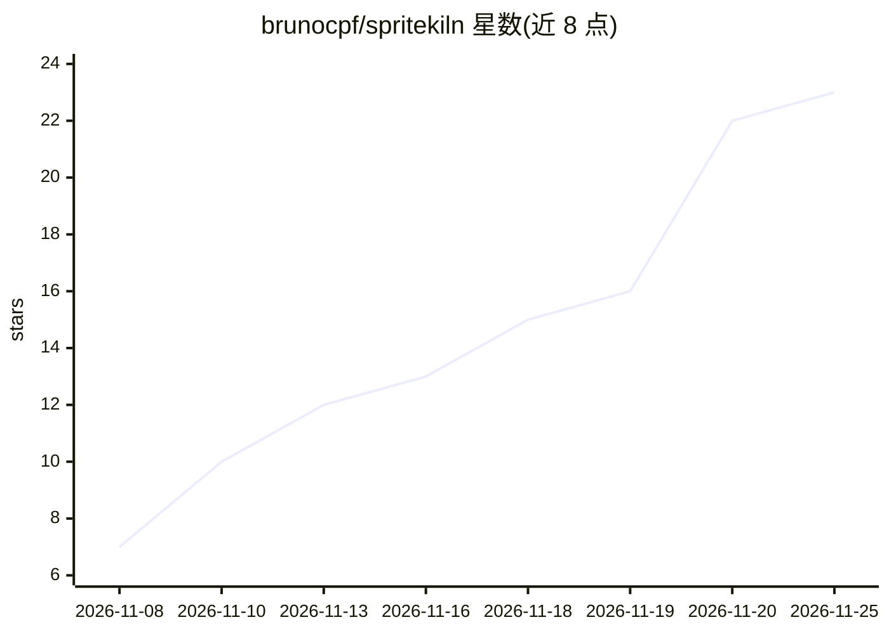

# brunocpf/spritekiln

⭐ 23 · Python · GPL-3.0 · 推送 2026-10-22 · [GitHub](https://github.com/brunocpf/spritekiln) · 个人维护

**本地生成 2D 游戏美术的 ComfyUI 节点包与工作流套件**

面向 2D 游戏美术制作者的 ComfyUI 节点包（41 个节点）、30 个现成工作流、模型下载器、脚本 CLI 与可选浏览器 UI。使用开源权重模型（Z-Image Turbo、FLUX.2 klein 4B、Wan 2.2 14B、SAM3.1 等）在本地生成像素/HD 风格精灵、旋转、动画、精灵表、瓦片集、装备图层、切割绑骨部件与法线贴图。输出经像素级对齐、调色板处理等管线；功能集对标 Retro Diffusion 与 PixelLab 等托管工具。在 Apple M5 Pro (48GB) macOS + ComfyUI 0.41 (MPS) 上开发测试，NVIDIA GPU 路径未测试；模型约 73 GB。

## 筛选速览

| 维度 | 判定 | 备注 |
|---|---|---|
| AI 角色 | `ai-native` | 本体是模型或模型工具 |
| 许可风险 | `viral` | GPL-3.0 |
| 部署形态 | `None` |  |
| 模型依赖 | — | README 未给出锁定关系 |
| 硬件要求 | — | 无带数字的原话,不猜 |
| 安装摩擦 | `low` | 无编译、无系统依赖或容器化 |
| 成熟度 | — | 结构信号不足 |

## 能力要点

- 41 个 ComfyUI 节点 + 30 个现成工作流覆盖生成/编辑/旋转/动画/精灵表/瓦片集
- SAM3.1 + FLUX.2 klein 的切割绑骨部件生成（Spine/DragonBones/Godot 兼容）
- 精灵法线贴图生成（含 MoGe-2 AI 法线混合）支持 Godot/Unity/Unreal 2D 光照
- 装备换装图层（paper doll）与自定义文本描述动画

## 适用场景

- 独立游戏开发者本地生成像素/HD 风格的角色与怪物精灵
- 为已有精灵生成 8 方向旋转、行走与攻击动画精灵表
- 制作可换装的角色图层与 2D 光照用法线贴图

## 场景标签

`图像生成` · 领域:内容生成

## 证据(README 行号)

> L3: **Free, local 2D game-art generation for ComfyUI**: pixel art and HD painted/cartoon art, sprites, rotations,
> L7: SpriteKiln is a ComfyUI node pack (`ComfyUI-SpriteKiln`, 41 nodes), a suite of 30 ready-made workflows, a model
> L18: Developed and tested on an **Apple M5 Pro (48 GB unified memory), macOS, ComfyUI 0.41 on MPS**. Every workflow in

## 星数曲线

2026-11-08 7 → 2026-11-25 23（+16）

---
*卡片 v1 · prompt 1.4 · 生成 2026-11-18 · 置信度 high · 依据 README sha `69ef0f1c80b0` · [字段定义](../../DATASET.md)*
