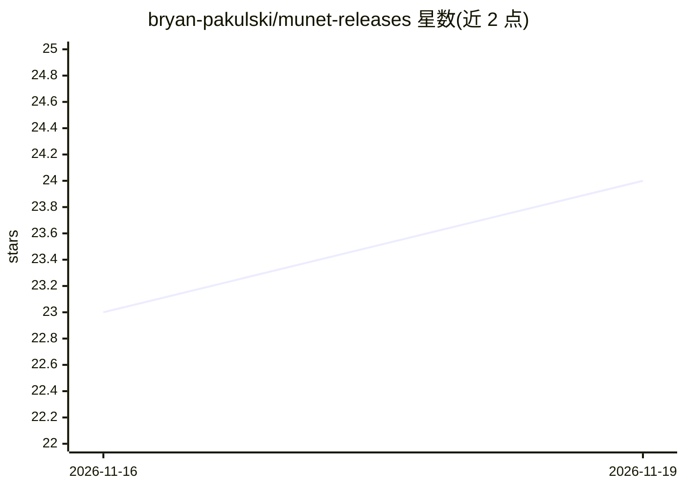

# bryan-pakulski/munet-releases

⭐ 24 · Rust · NOASSERTION · 推送 2026-11-16 · [GitHub](https://github.com/bryan-pakulski/munet-releases) · 个人维护

**MuNet 预编译二进制：将 ONNX 编译为 Vulkan compute kernel 的神经网络运行时**

提供 MuNet 引擎的多语言预编译分发：Python wheel、Rust crate、C 库（含头文件、动态/静态库）及原生工具（munet-node、munet-server、C++ SDK）。运行时将 ONNX 导入的模型编译为融合 Vulkan compute kernel，可在任何 Vulkan GPU 上运行（AMD/Intel/NVIDIA/Apple MoltenVK/移动端），支持 fp16/int8 cooperative-matrix kernel、多 GPU 与跨机分布式训练、int8/int4 量化，以及视频零拷贝检测。Linux x86_64/aarch64（glibc 2.28+）每版均有构建；GPU 运行需 Vulkan 1.1 驱动与 glslangValidator。引擎二进制为专有许可，无许可密钥时以评估模式运行。

## 筛选速览

| 维度 | 判定 | 备注 |
|---|---|---|
| AI 角色 | `ai-ecosystem` | LLM/agent 周边工具 |
| 许可风险 | `none` | NOASSERTION |
| 部署形态 | `library` | 以包/库形式分发 |
| 模型依赖 | — | README 未给出锁定关系 |
| 硬件要求 | — | 无带数字的原话,不猜 |
| 安装摩擦 | `low` | 无编译、无系统依赖或容器化 |
| 成熟度 | `idea` | |

## 能力要点

- 多语言预编译分发：Python wheel、Rust crate、C 库与原生工具
- ONNX 导入编译为融合 Vulkan compute kernel，跨厂商 GPU 运行
- 支持多 GPU（可混用不同显存大小）与跨机训练 swarm
- 内置诊断命令收集 GPU 信息以协助内核调优

## 适用场景

- 在 AMD/Intel/NVIDIA/Apple 等 Vulkan GPU 上运行和训练神经网络模型
- 从 Python、Rust、C/C++ 调用统一的推理与训练引擎
- 跨多台机器组合 GPU 做分布式训练

## 场景标签

`推理引擎` `模型训练` `模型量化` · 领域:训练与推理

## 证据(README 行号)

> L3: Prebuilt MuNet binaries: a neural-network runtime that compiles models (ONNX imports) into fused Vulkan compute
> L49: |Run models fast (precision, autotuning, batching, `.mnet`)|Inference and performance|

## 星数曲线

2026-11-16 23 → 2026-11-19 24（+1）

---
*卡片 v1 · prompt 1.4 · 生成 2026-11-18 · 置信度 high · 依据 README sha `db7db373f4f7` · [字段定义](../../DATASET.md)*
