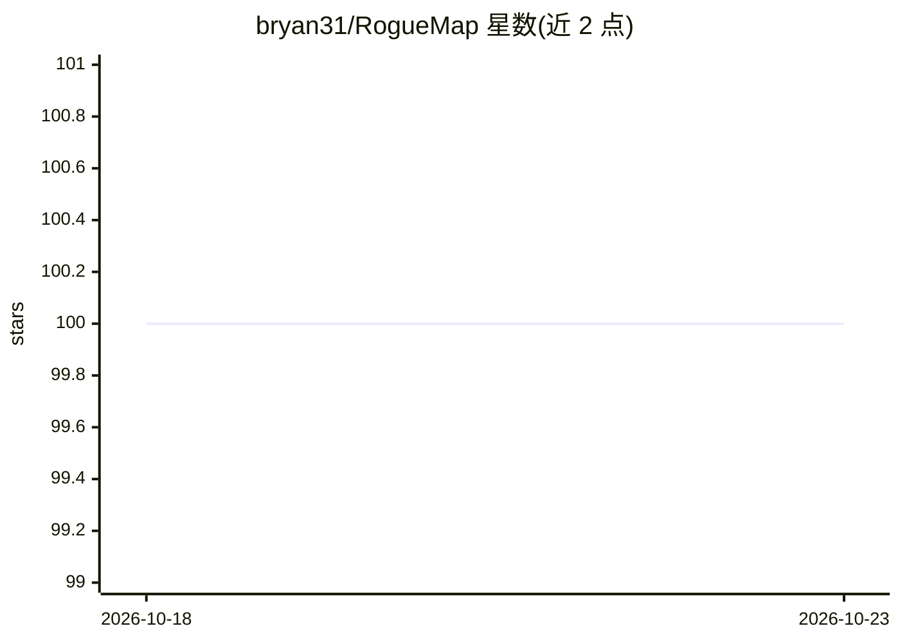

# bryan31/RogueMap

⭐ 100 · Java · Apache-2.0 · 推送 2026-07-14 · [GitHub](https://github.com/bryan31/RogueMap) · [官网](https://roguemap.yomahub.com) · 个人维护 · 中文 README

**Java 嵌入式堆外存储引擎，附向量+BM25 混合检索的 AI 记忆层**

基于内存映射文件的 JVM 堆外存储引擎，提供 RogueMap/List/Set/Queue 四种数据结构，支持持久化、原子多键事务、TTL、压实与检查点，核心库零强制依赖。其 AI 记忆层 RogueMemory 内置向量 ANN 与 BM25 关键词混合检索（Reciprocal Rank Fusion 融合），面向 AI Agent 长期记忆与 RAG 应用，无需外部向量数据库。嵌入服务经 UniversalEmbeddingProvider 接入任意 OpenAI 兼容端点（OpenAI/Mistral/Jina/Voyage/DashScope/智谱/Ollama/vLLM 等），自动推断向量维度。要求 Java 8+，Maven 安装。

## 筛选速览

| 维度 | 判定 | 备注 |
|---|---|---|
| AI 角色 | `ai-ecosystem` | LLM/agent 周边工具 |
| 许可风险 | `permissive` | Apache-2.0 |
| 部署形态 | `None` |  |
| 模型依赖 | local-ok | 支持本地模型 |
| 硬件要求 | — | 无带数字的原话,不猜 |
| 安装摩擦 | `medium` | 含编译或系统依赖之一 |
| 成熟度 | — | 结构信号不足 |

## 能力要点

- 四种 mmap 堆外数据结构，TB 级容量，零 GC 设计
- RogueMemory 混合向量 ANN + BM25 检索，RRF 融合
- 持久化、事务、TTL、压实、检查点与崩溃恢复（CRC32）
- UniversalEmbeddingProvider 零依赖接入 OpenAI 兼容嵌入端点并自动推断维度

## 适用场景

- 为 AI Agent 构建跨会话的持久长期记忆
- RAG 应用中做文档/知识检索，替代外部向量数据库
- Java 服务在堆外存储大规模 Map/List/Set/Queue 数据

## 场景标签

`Agent 记忆` `向量数据库` · 领域:Agent 开发

## 证据(README 行号)

> L23: Traditional Java collections and embedded databases focus solely on key-value or relational storage. RogueMap goes 
> L143: `roguemap-memory` provides a persistent AI memory store with hybrid vector + BM25 retrieval, backed by mmap storag

## 星数曲线

2026-10-18 100 → 2026-10-23 100（+0）

---
*卡片 v1 · prompt 1.4 · 生成 2026-10-23 · 置信度 high · 依据 README sha `b066501dc32d` · [字段定义](../../DATASET.md)*
