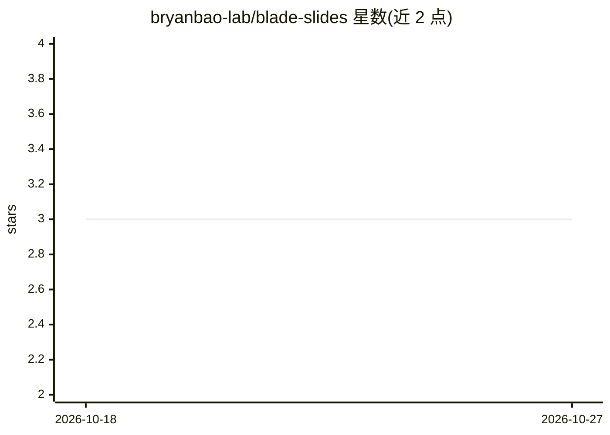

# bryanbao-lab/blade-slides

⭐ 3 · Python · MIT · 推送 2026-10-14 · [GitHub](https://github.com/bryanbao-lab/blade-slides) · 个人维护 · 中文 README

**将已验收幻灯片图片还原为可编辑 PowerPoint 的 Agent 技能包**

面向 AI Agent 的 SKILL 包：通过图层契约（layer contract）把获认可的平面幻灯片图片分类为原生文本、原生形状、透明资产与固定场景元素，重建为可在 Microsoft PowerPoint 中实际编辑的 PPTX。配套确定性 QA 脚本（契约验证、人类可编辑性审计、自检），支持单页重建与多页 deck 的多 Agent 编排。需 Python 3.10+ 与真实 PowerPoint 做最终验收；定位为保真优先的分层可编辑，非自动全量矢量化。

## 筛选速览

| 维度 | 判定 | 备注 |
|---|---|---|
| AI 角色 | `ai-ecosystem` | LLM/agent 周边工具 |
| 许可风险 | `permissive` | MIT |
| 部署形态 | `library` | 以包/库形式分发 |
| 模型依赖 | — | README 未给出锁定关系 |
| 硬件要求 | — | 无带数字的原话,不猜 |
| 安装摩擦 | `low` | 无编译、无系统依赖或容器化 |
| 成熟度 | — | 结构信号不足 |

## 动量与使用信号

- 安装:github 包 `release-assets` 月下载无数据

## 能力要点

- 图层契约将对象分类为 native_text/native_shape/transparent_png 等类型
- 确定性 QA 脚本：validate_layer_contract、audit_human_editability、self_check
- V2.2.0 支持多页 deck 的有界多 Agent 编排
- 中英双语 SKILL 与参考资料，可安装到 Codex 等 Agent 平台的 skill 目录

## 适用场景

- 把设计定稿的图片型 PPT/PDF 还原为可编辑的 PPTX 交付
- 审计已交付 deck 是否存在伪可编辑问题
- 在 AI Agent 中通过图层契约逐页重建并验证幻灯片

## 场景标签

 · 领域:办公文档/Agent 技能

## 证据(README 行号)

> L9: 先用图像方式制作 PPT，往往能得到很好的视觉效果；但最终页面通常会变成一张平面图。BLADE 提供一套 Agent 工作流、图层契约和确定性 QA 脚本，把已验收设计还原成实用的 PowerPoint 图层系统。
> L59: 需要：能读取 skill/instruction 目录的 AI Agent、Python 3.10+、Pillow、python-pptx；用于处理干净底图与透明素材的图像编辑或生成能力；以及用于最终验收的真实 Microsoft
> L79: 将仓库克隆或复制到平台的 skill/instruction 目录，并命名为 `blade-slides`。若平台忽略 YAML front matter，直接提供 `SKILL.md` 或中文场景下的 `SKILL.zh-CN.

## 星数曲线

2026-10-18 3 → 2026-10-27 3（+0）

---
*卡片 v1 · prompt 1.4 · 生成 2026-10-18 · 置信度 mid · 依据 README sha `f6c135483226` · [字段定义](../../DATASET.md)*
