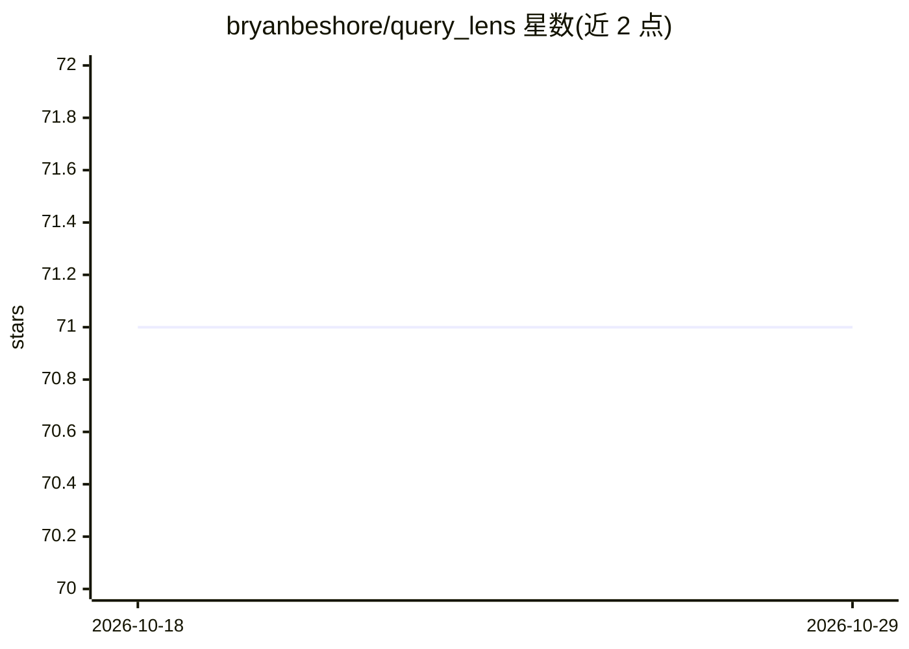

# bryanbeshore/query_lens

⭐ 71 · HTML · MIT · 推送 2026-02-16 · [GitHub](https://github.com/bryanbeshore/query_lens) · [官网](https://querylens.ai) · 个人维护

**Rails 可挂载引擎：自然语言提问生成 SQL 并查询数据库**

可挂载的 Rails engine，用户在 /query_lens 界面用自然语言提问，由 LLM（经 RubyLLM）生成 SQL 并在只读事务中执行，结果以可排序表格与 Chart.js 图表展示。支持 OpenAI、Anthropic、Gemini、DeepSeek、Ollama 等 10+ 供应商。机制上：数据库 schema 自省并缓存，50+ 表时采用两阶段表选择控制 token；安全层含只读事务、SQL 解析白名单、语句/函数黑名单、行数与超时限制、可配置认证与审计日志。保存查询按项目组织，对话历史跨刷新持久化（全员共享，无按用户隔离）。要求 Rails 7.1+、Ruby 3.2+，PostgreSQL 推荐（SQLite 无事务级只读强制）。

## 筛选速览

| 维度 | 判定 | 备注 |
|---|---|---|
| AI 角色 | `ai-ecosystem` | LLM/agent 周边工具 |
| 许可风险 | `permissive` | MIT |
| 部署形态 | `None` |  |
| 模型依赖 | local-ok | 支持本地模型 |
| 硬件要求 | — | 无带数字的原话,不猜 |
| 安装摩擦 | `low` | 无编译、无系统依赖或容器化 |
| 成熟度 | — | 结构信号不足 |

## 能力要点

- 自然语言经 LLM 生成 SQL 并在只读事务中执行
- 大数据库两阶段表选择（先选表再生成）与 schema 缓存
- 多层安全：SQL 解析白名单、语句/函数黑名单、excluded_tables、审计日志
- 保存查询按项目管理，对话历史自动保存并可恢复

## 适用场景

- 在 Rails 应用里让管理员用自然语言查询业务数据库
- 把已知可用 SQL 保存成项目化查询供复用
- 通过对话追问逐步细化数据查询

## 场景标签

`数据分析` · 领域:效率与自动化

## 证据(README 行号)

> L5: A mountable Rails engine that lets users write natural language questions and get SQL queries generated by AI, execu
> L7: Powered by RubyLLM, QueryLens works with any major AI provider: OpenAI, Anthropic (Claude), Google Gemini, DeepSeek,

## 星数曲线

2026-10-18 71 → 2026-10-29 71（+0）

---
*卡片 v1 · prompt 1.4 · 生成 2026-10-24 · 置信度 high · 依据 README sha `b8fbf377ecf1` · [字段定义](../../DATASET.md)*
