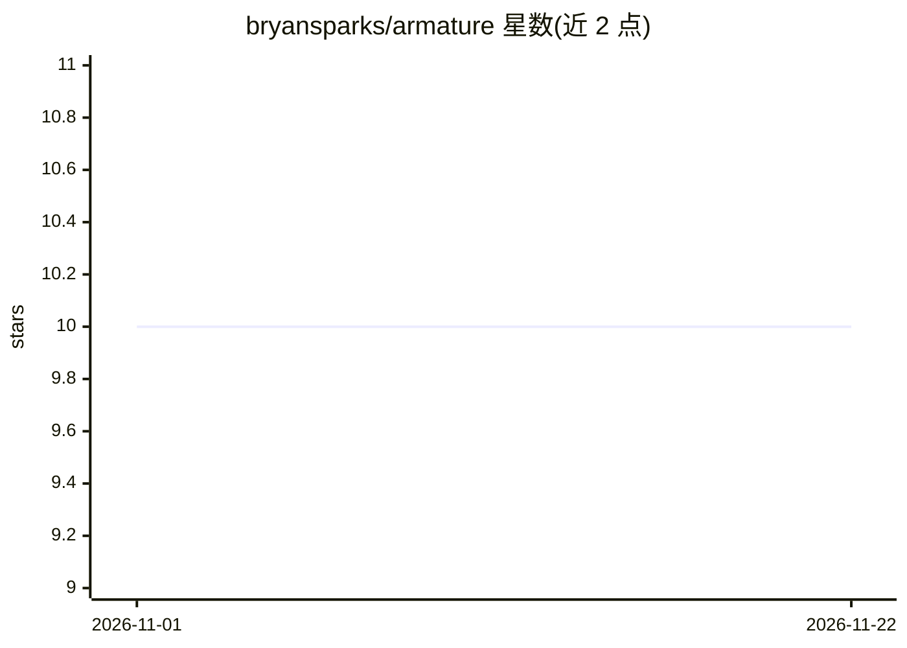

# bryansparks/armature

⭐ 10 · Python · MIT · 推送 2026-11-19 · [GitHub](https://github.com/bryansparks/armature) · [官网](https://armature.now) · 个人维护

**面向开发者的 YAML 声明式多智能体工作流执行引擎**

Armature 以 Python 库和 CLI 形式提供：用户将多智能体工作流写为 YAML 规范（DAG 阶段图），引擎负责解析执行顺序、传递上下文、重试、安全钩子、遥测与人工审批门。阶段类型包括 LLM 调用、脚本/适配器、人工审批、确定性工具调用与子工作流。核心安装无框架依赖；可选 extras 提供平台服务器（Web UI、团队、Webhook）、FastAPI HTTP 服务、云传输、OpenTelemetry 与交互式向导。需要 Python 3.11+，LLM 密钥经环境变量配置。

## 筛选速览

| 维度 | 判定 | 备注 |
|---|---|---|
| AI 角色 | `ai-ecosystem` | LLM/agent 周边工具 |
| 许可风险 | `permissive` | MIT |
| 部署形态 | `library` | 以包/库形式分发 |
| 模型依赖 | local-ok | 支持本地模型 |
| 硬件要求 | — | 无带数字的原话,不猜 |
| 安装摩擦 | `low` | 无编译、无系统依赖或容器化 |
| 成熟度 | — | 结构信号不足 |

## 能力要点

- YAML 定义 DAG 工作流，Python 或 CLI 单命令运行
- 五类阶段：LLM 调用、脚本、人工审批、工具调用、子智能体
- 可经 Ollama 运行本地模型，无需 API 密钥
- 平台服务器提供 Web UI、团队、Webhook 与常驻工作流

## 适用场景

- 把多智能体业务流程写为 YAML 并由引擎编排执行
- 在平台服务器上通过 Web UI 管理工作流、团队与 Webhook
- 用工作流包构建可移植的容器化运行单元
- 无云端密钥环境下用本地模型运行智能体流程

## 场景标签

`Agent 框架` `多智能体` · 领域:Agent 开发

## 证据(README 行号)

> L7: A lightweight, declarative agent execution harness. Define multi-agent workflows as YAML specs. Run them with a sing
> L11: No framework dependency. No prescribed team structure. Just a DAG executor, an LLM adapter, and your workflow spec.
> L13: Armature is the execution engine for **Reasoning Automation** — end-to-end business processes where multi-agent del

## 星数曲线

2026-11-01 10 → 2026-11-22 10（+0）

---
*卡片 v1 · prompt 1.4 · 生成 2026-11-19 · 置信度 high · 依据 README sha `14b2293d44c7` · [字段定义](../../DATASET.md)*
