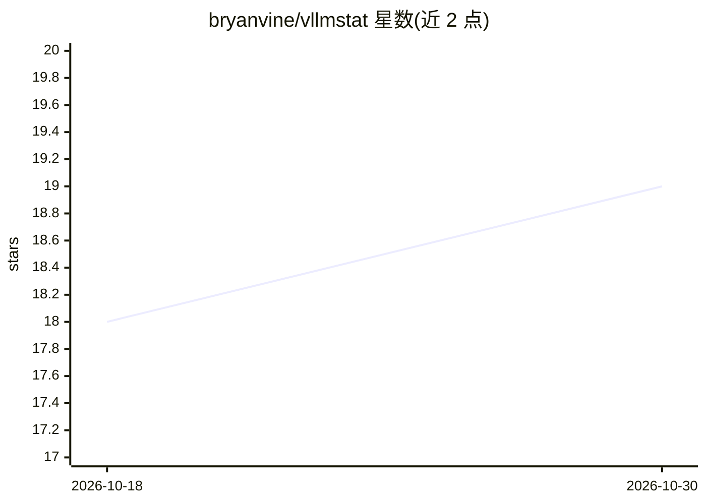

# bryanvine/vllmstat

⭐ 19 · Python · Apache-2.0 · 推送 2026-06-25 · [GitHub](https://github.com/bryanvine/vllmstat) · 个人维护

**vLLM 推理服务性能的终端监控仪表盘（nvtop 风格）**

基于 Textual 的交互式 TUI，直接抓取 vLLM 内置 /metrics 端点在终端渲染：并发与队列、吞吐、前缀缓存命中率与 KV 内存、TTFT/TPOT 延迟分位、投机解码接受率、能效与能耗成本（SQLite 持久化 daemon）、配置建议面板，以及 NVIDIA/AMD/Intel 逐 GPU 状态。支持多实例 fleet 总览、Docker 容器自动发现、--once --json 脚本化输出与代理模式查看完整 prompt/响应。面向运行 vLLM 服务器的开发与运维人员，零基础设施，一条命令启动。

## 筛选速览

| 维度 | 判定 | 备注 |
|---|---|---|
| AI 角色 | `ai-ecosystem` | LLM/agent 周边工具 |
| 许可风险 | `permissive` | Apache-2.0 |
| 部署形态 | `library` | 以包/库形式分发 |
| 模型依赖 | local-ok | 支持本地模型 |
| 硬件要求 | — | 无带数字的原话,不猜 |
| 安装摩擦 | `medium` | 含编译或系统依赖之一 |
| 成熟度 | — | 结构信号不足 |

## 能力要点

- 从 /metrics 端点直接抓取，每秒刷新，无需 Prometheus/Grafana
- KV 缓存利用率、量化 KV 压缩比、投机解码接受率等指标面板
- fleet 多实例总览与 Docker 容器自动发现（零配置回退）
- 能耗成本长期记录（daemon + SQLite）与配置建议面板

## 适用场景

- 在终端实时观察 vLLM 服务的并发、吞吐与延迟
- 多台机器/多个容器的 vLLM 实例统一总览并下钻查看
- 用 --once --json 输出快照接入脚本告警
- 依据 max-context 与配置建议调优 vLLM 参数

## 场景标签

`LLM 可观测性` · 领域:评测与运维

## 证据(README 行号)

> L3: **`nvtop` for vLLM** — a zero-infrastructure interactive terminal dashboard for vLLM serving performance.
> L11: `vllmstat` replaces that for day-to-day monitoring. One command, no infrastructure. It scrapes the vLLM server's bu

## 星数曲线

2026-10-18 18 → 2026-10-30 19（+1）

---
*卡片 v1 · prompt 1.4 · 生成 2026-10-29 · 置信度 high · 依据 README sha `5c6d6d25f194` · [字段定义](../../DATASET.md)*
