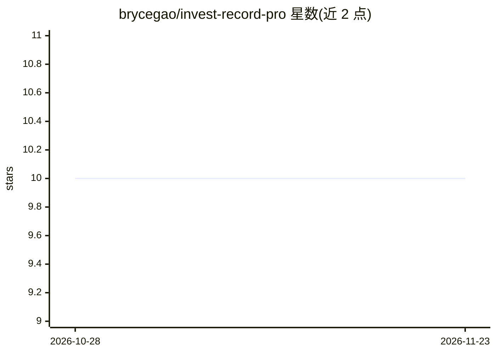

# brycegao/invest-record-pro

⭐ 10 · TypeScript · MIT · 推送 2026-06-04 · [GitHub](https://github.com/brycegao/invest-record-pro) · 个人维护 · 中文 README

**给个人投资者的本地离线投资记账与 AI 复盘桌面应用**

基于 Tauri 2 + Rust + Vue 3 的跨平台桌面应用，功能覆盖投资标的管理、交易计划编制、交易录入、持仓快照、逐笔复盘与 AI 月度报告；数据加密存放在本地 SQLite，声明无联网上报。AI 能力通过对接 Ollama 本地大模型实现断网可用的单笔点评、月度复盘与交易纪律诊断，在设置页配置模型。开发者需 Node.js≥18、Rust 从源码构建，普通用户从 GitHub Releases 下载 Windows/macOS 安装包。

## 筛选速览

| 维度 | 判定 | 备注 |
|---|---|---|
| AI 角色 | `ai-enhanced` | 去掉 AI 部分产品仍成立 |
| 许可风险 | `permissive` | MIT |
| 部署形态 | `library` | 以包/库形式分发 |
| 模型依赖 | local-ok | 支持本地模型 |
| 硬件要求 | — | 无带数字的原话,不猜 |
| 安装摩擦 | `low` | 无编译、无系统依赖或容器化 |
| 成熟度 | — | 结构信号不足 |

## 能力要点

- 全本地加密 SQLite 存储，声明无数据联网上传
- 对接 Ollama 本地大模型，断网可用 AI 复盘
- 交易计划执行率量化统计与纪律诊断
- 金融数据以 INTEGER 存储（金额×100 等）避免浮点精度问题

## 适用场景

- 离线环境记录个人交易并生成月度复盘报告
- 量化检查自己交易计划的执行率
- 本地管理股票/ETF/基金等标的的持仓与盈亏

## 场景标签

`金融量化` · 领域:学习与行业

## 证据(README 行号)

> L13: > 所有交易、持仓、复盘数据加密存放本地SQLite，无任何联网上报；依托Ollama实现断网可用的AI投资复盘，一站式完成标的管理、交易记账、仓位统计与月度分析。
> L18: - 🤖 **离线本地化AI分析**：对接Ollama本地大模型，断网环境照常实现单笔交易点评、月度投资复盘、交易纪律诊断

## 星数曲线

2026-10-28 10 → 2026-11-23 10（+0）

---
*卡片 v1 · prompt 1.4 · 生成 2026-11-19 · 置信度 high · 依据 README sha `32a1c58273a4` · [字段定义](../../DATASET.md)*
