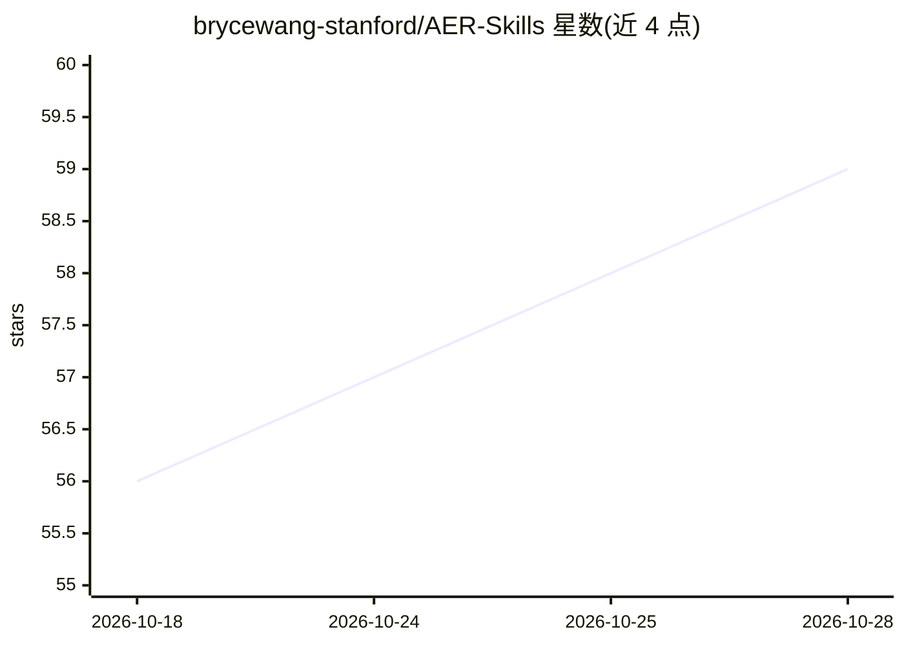

# brycewang-stanford/AER-Skills

⭐ 60 · Python · MIT · 推送 2026-07-15 · [GitHub](https://github.com/brycewang-stanford/AER-Skills) · 个人维护 · 中文 README

**面向 AER/AEJ 经济学期刊的论文写作 agent skill 栈**

覆盖选题、文献定位、识别策略、正文写作、表格规范、投稿、模拟审稿到 R&R 回复的 15 个 agent skill 包，服务于向 AER、AER: Insights 及 AEJ 系列投稿的经济学研究者。核心机制：识别优先的实证流程（DiD/IV/RDD/SCM 等）、引用必须经 Crossref/OpenAlex 核验的硬门、数值正确性契约 demo、以 CI 强制的质量门。安装后 skill 自包含捆绑深度参考文件，通过 Claude Code 插件或脚本安装，可选 StatsPAI 引擎执行分析。不适用于金融三大刊与纯理论稿件。

## 筛选速览

| 维度 | 判定 | 备注 |
|---|---|---|
| AI 角色 | `ai-native` | 本体是模型或模型工具 |
| 许可风险 | `permissive` | MIT |
| 部署形态 | `None` |  |
| 模型依赖 | locked-api |  |
| 硬件要求 | — | 无带数字的原话,不猜 |
| 安装摩擦 | `low` | 无编译、无系统依赖或容器化 |
| 成熟度 | — | 结构信号不足 |

## 能力要点

- 15 个 skill 覆盖选题到 R&R 回复的全生命周期
- 引用核验门：每条引用须对照 Crossref/OpenAlex 源记录，杜绝幻觉引用
- 数值正确性契约：多个可运行 Monte Carlo demo 钉到已知真值断言
- 提供 Stata/R/Python 三套代码模板与项目脚手架脚本

## 适用场景

- 准备向 AER/AER:Insights/AEJ 投稿的实证经济学论文
- 投稿前跑一致性审计与对抗性模拟审稿自查
- 搭建 AEA 政策合规的复现包与 openICPSR 投稿骨架
- 撰写 R&R 回复信并决定让步/澄清/反驳策略

## 场景标签

`AI 写作` `科研工具` · 领域:内容生成

## 证据(README 行号)

> L18: 面向 *American Economic Review*（AER）、*AER: Insights* 以及 *AEJ* 系列期刊的 **agent skill 包**：覆盖**选题、文献定位、正文写作、识别策略、表图规范、投稿、模
> L141: |Skill|用途|

## 星数曲线

2026-10-18 56 → 2026-10-28 59（+3）

---
*卡片 v1 · prompt 1.4 · 生成 2026-10-24 · 置信度 high · 依据 README sha `9d1da4156ccd` · [字段定义](../../DATASET.md)*
