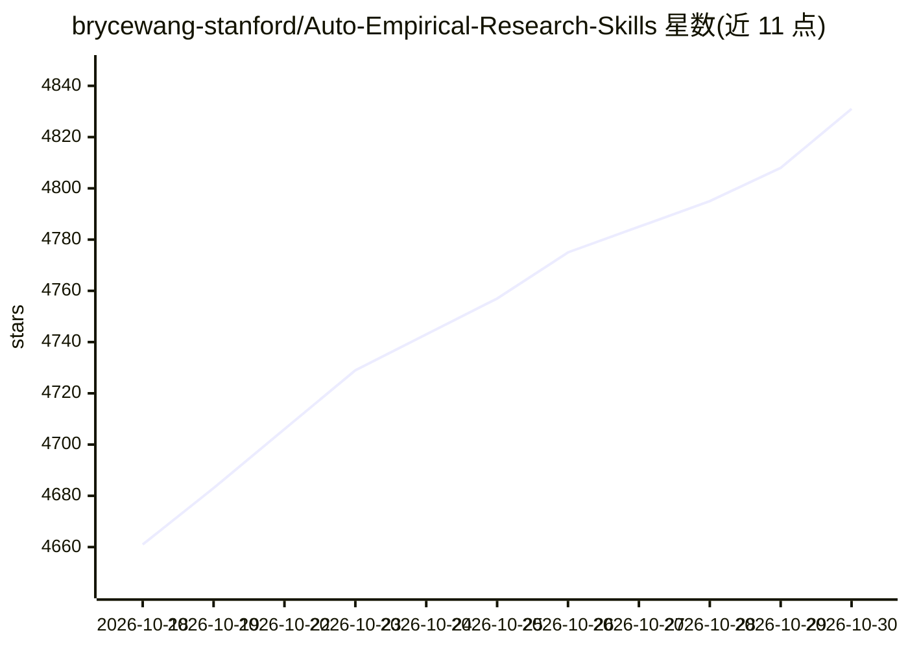

# brycewang-stanford/Auto-Empirical-Research-Skills

⭐ 4,831 · Stata · NOASSERTION · 推送 2026-10-26 · [GitHub](https://github.com/brycewang-stanford/Auto-Empirical-Research-Skills) · [官网](https://copaper.ai) · 组织维护 · 中文 README

**社科实证研究 Agent 技能策展库：77 合集 1,107 个 skill**

由 Stanford REAP × CoPaper.AI 维护的实证研究 Agent 技能聚合仓库：收录 77 个合集、1,107 个 skill（仓库描述另称 23,000+，统计以 catalog/skills.json 为准），覆盖选题、文献综述、数据获取、因果识别、估计建模、稳健性审计、出版级图表、写作与降 AIGC 九个阶段。其中 7 个为团队自研（含 StatsPAI 因果引擎与 Paper-WorkFlow 元编排器），其余为社区合集的上游快照并附来源链接。支持 Claude Code 插件市场安装、URL 交给 Agent 自动安装或 git clone 后拷贝文件夹。附 19 项数值 benchmark 与 42 项行为评测的信任面统计，许可为 CC BY-SA 4.0。

## 筛选速览

| 维度 | 判定 | 备注 |
|---|---|---|
| AI 角色 | `ai-knowledge` | 知识聚合/清单类 |
| 许可风险 | `none` | NOASSERTION |
| 部署形态 | `library` | 以包/库形式分发 |
| 模型依赖 | — | README 未给出锁定关系 |
| 硬件要求 | — | 无带数字的原话,不猜 |
| 安装摩擦 | `low` | 无编译、无系统依赖或容器化 |
| 成熟度 | — | 结构信号不足 |

## 能力要点

- 77 个合集、1,107 个 skill，vendor 进仓库并由 catalog/skills.json 跟踪
- 九阶段论文流水线：选题到投稿，各阶段可人工介入
- 7 个自研 skill 含 StatsPAI 因果引擎（900+ 函数）与 Paper-WorkFlow 元编排器
- 17+ 项数值 benchmark 与行为评测构成的信任面统计

## 适用场景

- 为 Claude Code / Codex 等 agent 配备实证研究技能
- 用自然语言驱动从 idea 到论文的端到端流水线
- 按合集查找因果推断、计量经济学或学术写作类技能

## 场景标签

`精选清单` `科研工具` · 领域:学习与行业

## 证据(README 行号)

> L174: > **打开仓库 → 看见整座库。** 全部 **77 个合集 · 1,107 个 skill**，每一个都已 vendor 进本仓库，由 `catalog/skills.json` 跟踪。**⭐ = Stanford REAP
> L119: > **AERS 不只是 77 个散装 skill —— 它能陪你走完一篇论文。** 从模糊 idea → 选题精炼 → 文献综述 → 数据获取 → 识别策略 → 估计建模 → 稳健性审计 → 出版级表格 / 图形 → 写作与同

## 星数曲线

2026-10-18 4,661 → 2026-10-30 4,831（+170）

---
*卡片 v1 · prompt 1.4 · 生成 2026-10-20 · 置信度 mid · 依据 README sha `fbd0ec548e8f` · [字段定义](../../DATASET.md)*
