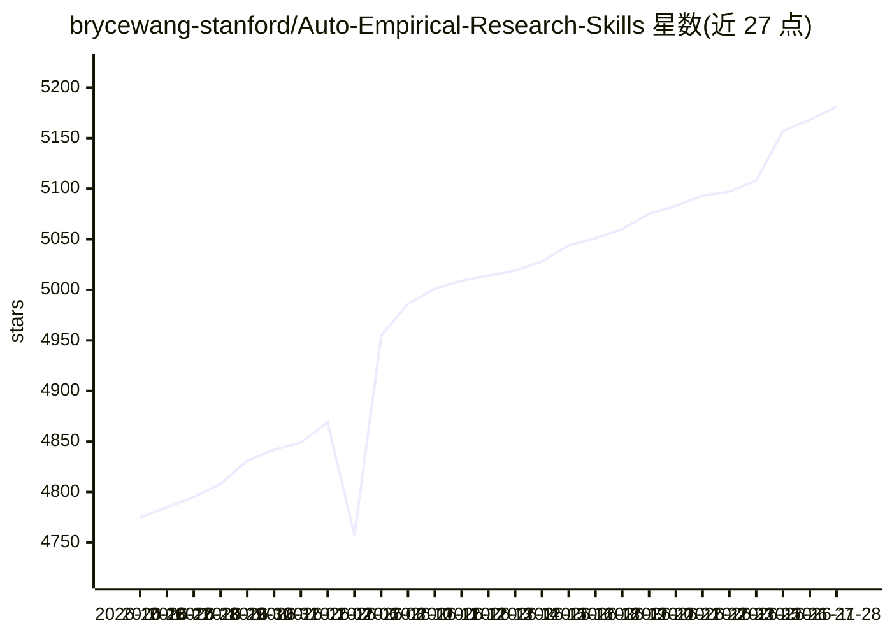

# brycewang-stanford/Auto-Empirical-Research-Skills

⭐ 5,181 · Stata · NOASSERTION · 推送 2026-11-24 · [GitHub](https://github.com/brycewang-stanford/Auto-Empirical-Research-Skills) · [官网](https://copaper.ai) · 组织维护 · 中文 README

**面向社科实证研究的 AI Agent 技能策展库**

由 Stanford REAP（CoPaper.AI）维护的 Agent 技能合集仓库，将 78 个合集、1,151 个 skill vendor 进本仓库，按选题、文献综述、数据获取、识别策略、估计建模、稳健性审计、表格图形、写作评审、投稿 9 个阶段组织，覆盖 Python/Stata/R 三条计量流水线。提供 Skill Search 过滤、`make validate` 目录校验、19 项数值 benchmark 与 42 项行为评测场景。安装方式包括把仓库 URL 交给 Claude Code/Codex 自动安装、Claude 插件市场命令、以及 git clone 后手动拷贝 skill 文件夹。

## 筛选速览

| 维度 | 判定 | 备注 |
|---|---|---|
| AI 角色 | `ai-knowledge` | 知识聚合/清单类 |
| 许可风险 | `none` | NOASSERTION |
| 部署形态 | `library` | 以包/库形式分发 |
| 模型依赖 | — | README 未给出锁定关系 |
| 硬件要求 | — | 无带数字的原话,不猜 |
| 安装摩擦 | `low` | 无编译、无系统依赖或容器化 |
| 成熟度 | — | 结构信号不足 |

## 能力要点

- 78 个合集、1,151 个 skill 按实证研究 9 阶段流水线组织
- 端到端 Paper-WorkFlow 元编排器串联各阶段 skill，支持人工介入
- 内置 benchmark 与 eval-harness，提供 aers-score 外部评分榜
- 多语言 README 与 docs/CONTENT_ZH.md 分级中文文档

## 适用场景

- 为 Claude Code/Codex 查找社会科学实证研究类 agent 技能
- 从研究 idea 到投稿用 agent 流水线完成一篇实证论文
- 给自研 agent 用同一套 benchmark 跑分对比

## 场景标签

`编码 Agent` `模型评测` `精选清单` `科研工具` · 领域:编码与开发

## 证据(README 行号)

> L33: > ### 🚀 New here? Open the **Skill Search →** to filter all 1,151 skills by method, stage, language, and license. T
> L184: > **打开仓库 → 看见整座库。** 全部 **78 个合集 · 1,151 个 skill**，每一个都已 vendor 进本仓库，由 `catalog/skills.json` 跟踪。**⭐ = Stanford REAP
> L129: > **AERS 不只是 78 个散装 skill —— 它能陪你走完一篇论文。** 从模糊 idea → 选题精炼 → 文献综述 → 数据获取 → 识别策略 → 估计建模 → 稳健性审计 → 出版级表格 / 图形 → 写作与同

## 星数曲线

2026-10-26 4,775 → 2026-11-28 5,181（+406）

---
*卡片 v1 · prompt 1.4 · 生成 2026-11-22 · 置信度 high · 依据 README sha `47efac6d85ff` · [字段定义](../../DATASET.md)*
