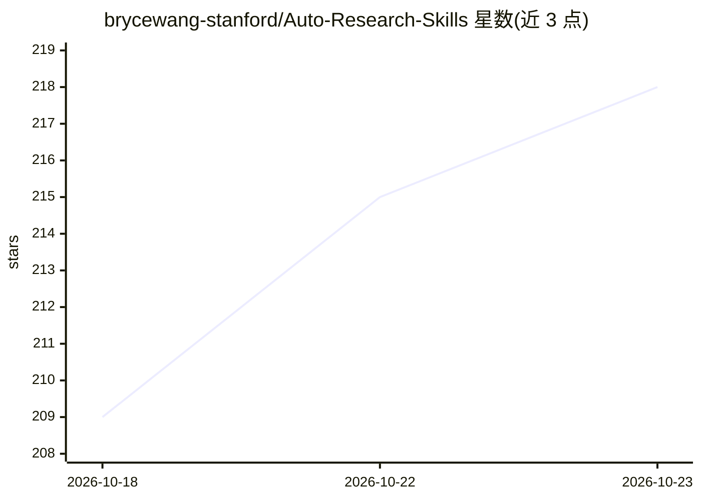

# brycewang-stanford/Auto-Research-Skills

⭐ 218 · Python · CC0-1.0 · 推送 2026-10-20 · [GitHub](https://github.com/brycewang-stanford/Auto-Research-Skills) · 个人维护 · 中文 README

**自主科研技能与智能体精选清单（6,089 skills/110 仓库）**

社区维护的自动化研究资源合集：以 git 子模块（浅克隆）形式收录 6,089 个 skills、110 个仓库，划分为 skills/、systems/、benchmarks/、lists/ 四个目录，供 Claude Code、Codex、OpenClaw 等编码智能体调用。内容按端到端研究系统、深度研究与文献综合、自动化实验、领域科学智能体、研究技能合集等类别组织，含 Star 排行榜、新手入门包与冲突清单。安装方式为 git clone 后运行 setup.sh。

## 筛选速览

| 维度 | 判定 | 备注 |
|---|---|---|
| AI 角色 | `ai-knowledge` | 知识聚合/清单类 |
| 许可风险 | `viral` | CC0-1.0 |
| 部署形态 | `None` |  |
| 模型依赖 | — | README 未给出锁定关系 |
| 硬件要求 | — | 无带数字的原话,不猜 |
| 安装摩擦 | `low` | 无编译、无系统依赖或容器化 |
| 成熟度 | — | 结构信号不足 |

## 能力要点

- 6,089 个 skills 分布于 110 个仓库，git 子模块浅克隆打包
- 四目录分类：skills/systems/benchmarks/lists
- Star 排行榜由 GitHub Action 每周自动刷新
- 提供 STARTER-KITS 与技能同名冲突清单（collisions.json）

## 适用场景

- 为 Claude Code/Codex 等编码智能体查找科研技能
- 了解自动化科研系统的生态分布
- 按科研阶段挑选入门技能包

## 场景标签

`精选清单` `科研工具` · 领域:学习与行业

## 证据(README 行号)

> L9:  🧩 已收录 6,089 个 skills ，分布在 110 个仓库 中 —— 一次克隆拿到整套研究工具箱。
> L55: > **这是什么？** 一个社区精选的**自动化研究**中心 —— 收纳可复用技能（skills）、端到端系统（systems）、领域科学智能体、评测基准（benchmarks）、以及精选清单（lists），打包好让编码智能体（C

## 星数曲线

2026-10-18 209 → 2026-10-23 218（+9）

---
*卡片 v1 · prompt 1.4 · 生成 2026-10-22 · 置信度 high · 依据 README sha `9fe6a41c4834` · [字段定义](../../DATASET.md)*
