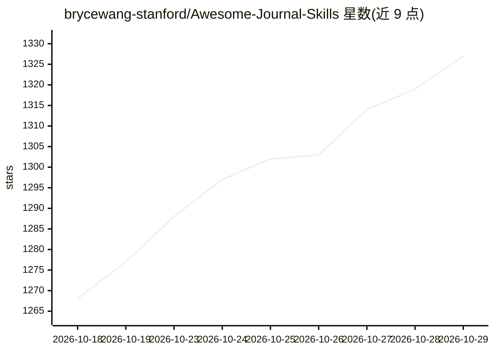

# brycewang-stanford/Awesome-Journal-Skills

⭐ 1,327 · Stata · MIT · 推送 2026-09-27 · [GitHub](https://github.com/brycewang-stanford/Awesome-Journal-Skills) · [官网](https://www.copaper.ai) · 组织维护 · 中文 README

**覆盖 744 期刊/会议的 Claude Code/Codex 学术投稿技能包清单**

按期刊与会议组织的 Agent Skill 包索引：收录 300 个 pack、4166 个 skill，覆盖 11 个学科板块、744 个 venue。每个深度包针对单一期刊编码编委偏好、格式规范与审稿文化，覆盖选题、识别策略、表格规范、投稿与修改回复全流程；广度合集为每本刊提供轻量选刊定位 skill。支持 Claude Code 插件机制安装，附带基于两套词表的 venue 匹配脚本与评测结果。由 Stanford REAP 与 CoPaper.AI 维护。

## 筛选速览

| 维度 | 判定 | 备注 |
|---|---|---|
| AI 角色 | `ai-knowledge` | 知识聚合/清单类 |
| 许可风险 | `permissive` | MIT |
| 部署形态 | `None` |  |
| 模型依赖 | — | README 未给出锁定关系 |
| 硬件要求 | — | 无带数字的原话,不猜 |
| 安装摩擦 | `low` | 无编译、无系统依赖或容器化 |
| 成熟度 | — | 结构信号不足 |

## 能力要点

- 4166 个 skill、300 个 pack、744 个期刊与会议 venue
- 单刊深度包覆盖选题到审稿回复的投稿全流程
- 跨刊选刊工具 rt-journal-match 与 match_venues.py 匹配脚本
- 以 Claude Code 插件（marketplace/plugin install）方式安装

## 适用场景

- 确定目标期刊后安装对应深度包辅助投稿
- 未定投稿目标时用跨刊工具包匹配候选期刊
- 查阅各学科期刊/会议的技能包覆盖情况

## 场景标签

`精选清单` `科研工具` · 领域:学习与行业

## 证据(README 行号)

> L3:  Awesome Journal Skills (AJS)：4166 个 Agent Skill、300 个 Pack、744 个期刊与会议 venue
> L350:  共 300 个 pack / 4166 个 skill 。"深度包"= 单刊单会全流程（约 12 个 skill）；"广度合集"= 每个 venue 一个轻量"选刊定位 + 写作风格"skill 加一个 router。

## 星数曲线

2026-10-18 1,268 → 2026-10-29 1,327（+59）

---
*卡片 v1 · prompt 1.4 · 生成 2026-10-21 · 置信度 high · 依据 README sha `799f2368db03` · [字段定义](../../DATASET.md)*
