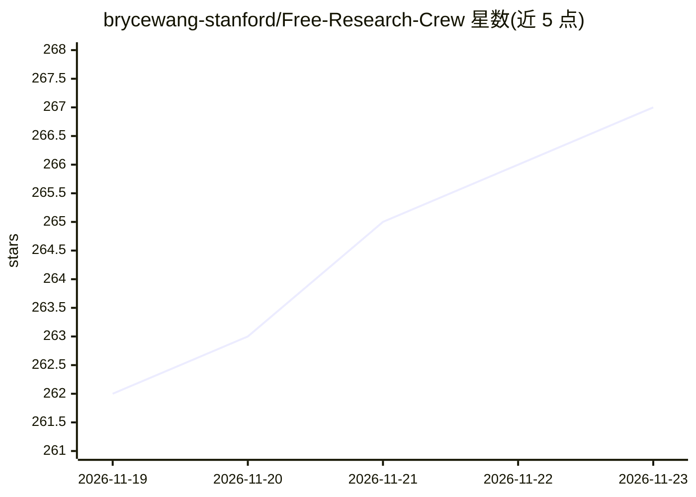

# brycewang-stanford/Free-Research-Crew

⭐ 267 · Python · CC0-1.0 · 推送 2026-11-21 · [GitHub](https://github.com/brycewang-stanford/Free-Research-Crew) · 组织维护 · 中文 README

**免费助研 AI 团队：协作完成 CS 与社科论文**

以 Claude Code 插件形式提供的多智能体研究团队（v0.1），内含 PI/文献/设计/计量/实验/数据/图表/写作/复现/审稿 10 个角色，分 CS 与社科两条赛道协作完成论文。机制上设四道人工关卡（问题→设计→结果→投稿），设计未批准不跑分析，每个数字由有记录的运行生成，引用逐条核验。依托仓库收录的 6,089 个 skills（110 个仓库，git 子模块形式），CC0 许可，fork 自定义赛道；README 注明尚未在种子任务上完整跑通。

## 筛选速览

| 维度 | 判定 | 备注 |
|---|---|---|
| AI 角色 | `ai-native` | 本体是模型或模型工具 |
| 许可风险 | `viral` | CC0-1.0 |
| 部署形态 | `None` |  |
| 模型依赖 | locked-api |  |
| 硬件要求 | — | 无带数字的原话,不猜 |
| 安装摩擦 | `low` | 无编译、无系统依赖或容器化 |
| 成熟度 | `idea` | |

## 能力要点

- 10 个 RA 角色分工，四道人工关卡控制研究流程
- 收录 6,089 个 skills 分布于 110 个仓库，git 子模块一次克隆
- 机制保证可复现：图表由脚本从有记录的运行生成，引用逐条核验
- CC0 许可，角色文件为 Markdown/Python，可自由修改扩展

## 适用场景

- 让 AI 助研团队协作完成一篇带真实验的 CS 或社科论文
- 单独使用其收录的自动化研究技能库
- 社科研究中让智能体在 Stata 里跑 DiD/IV/RDD 并产出可复现论文

## 场景标签

`多智能体` `科研工具` `数据分析` `精选清单` · 领域:Agent 开发

## 证据(README 行号)

> L5:  你的免费助研团。 一支 AI 助研（RA）团队，把一个研究问题做成一篇完整的
> L6:  计算机科学 或 社会科学 论文 —— 真实验、真数据，而你始终是 PI。
> L33: 好的助研又贵又难找。**免费助研团（Free-Research-Crew）** 免费给你一整支团队：多个 AI 助研像真实课题组一样分工完成一篇论文 —— 而每个关键决策都交还给你这位 PI。

## 星数曲线

2026-11-19 262 → 2026-11-23 267（+5）

---
*卡片 v1 · prompt 1.4 · 生成 2026-11-19 · 置信度 high · 依据 README sha `e61a33379d9b` · [字段定义](../../DATASET.md)*
