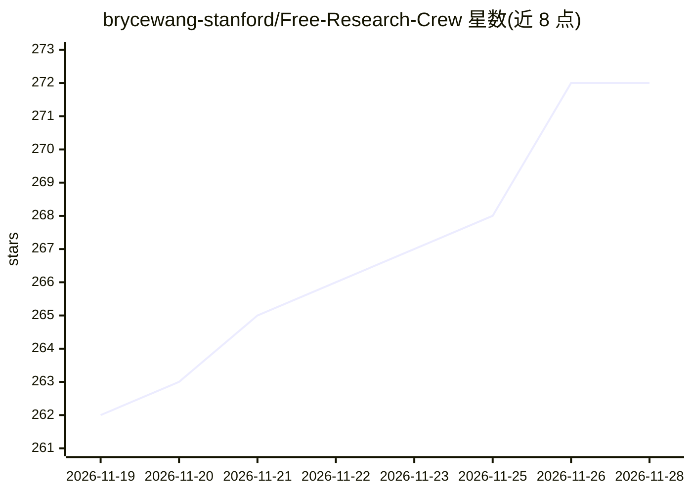

# brycewang-stanford/Free-Research-Crew

⭐ 272 · Python · CC0-1.0 · 推送 2026-11-23 · [GitHub](https://github.com/brycewang-stanford/Free-Research-Crew) · 组织维护 · 中文 README

**给研究者的多智能体助研团，协作产出 CS 与社科论文**

以 Claude Code 插件形式安装的多智能体助研团队：Scout/Designer/Experimenter/Writer/Reviewer 等 10 类角色分工，完成文献核验、实验、计量分析与 LaTeX 论文起草。内置四道人工审批关卡（问题→设计→结果→投稿），智能体不能替用户批准；引用逐条核验、每个数字由有记录的运行生成。运行依赖已有的 Claude Code、Python 3.9+ 与 LaTeX，不另付 API 费用。仓库同时收录 6,089 个研究 skills（110 个仓库，git 子模块）作工具箱。

## 筛选速览

| 维度 | 判定 | 备注 |
|---|---|---|
| AI 角色 | `ai-native` | 本体是模型或模型工具 |
| 许可风险 | `viral` | CC0-1.0 |
| 部署形态 | `None` |  |
| 模型依赖 | locked-api |  |
| 硬件要求 | — | 无带数字的原话,不猜 |
| 安装摩擦 | `low` | 无编译、无系统依赖或容器化 |
| 成熟度 | — | 结构信号不足 |

## 能力要点

- 10 类 RA 角色分工协作，覆盖 CS 与社科两条赛道
- 四道人工关卡，设计未批准前不能跑分析
- 6,089 个 skills 分布于 110 个仓库，git 子模块一次克隆
- 提供 Codex 适配器（crew/adapters/codex）

## 适用场景

- 从研究问题出发跑完整实验并成稿 CS/社科论文
- 复现已发表研究（DML、DiD、RDD 等种子任务）
- 检索并按需安装社区自动化研究技能

## 场景标签

`多智能体` `科研工具` `数据分析` `编码 Agent` · 领域:Agent 开发

## 证据(README 行号)

> L5:  你的免费助研团。 一支 AI 助研（RA）团队，把一个研究问题做成一篇完整的
> L33: 好的助研又贵又难找。**免费助研团（Free-Research-Crew）** 免费给你一整支团队：多个 AI 助研像真实课题组一样分工完成一篇论文 —— 而每个关键决策都交还给你这位 PI。
> L62: **助研团 v0.1 已在 `crew/` 中**，以 Claude Code 插件形式提供：

## 星数曲线

2026-11-19 262 → 2026-11-28 272（+10）

---
*卡片 v1 · prompt 1.4 · 生成 2026-11-25 · 置信度 high · 依据 README sha `526a42ff58c0` · [字段定义](../../DATASET.md)*
