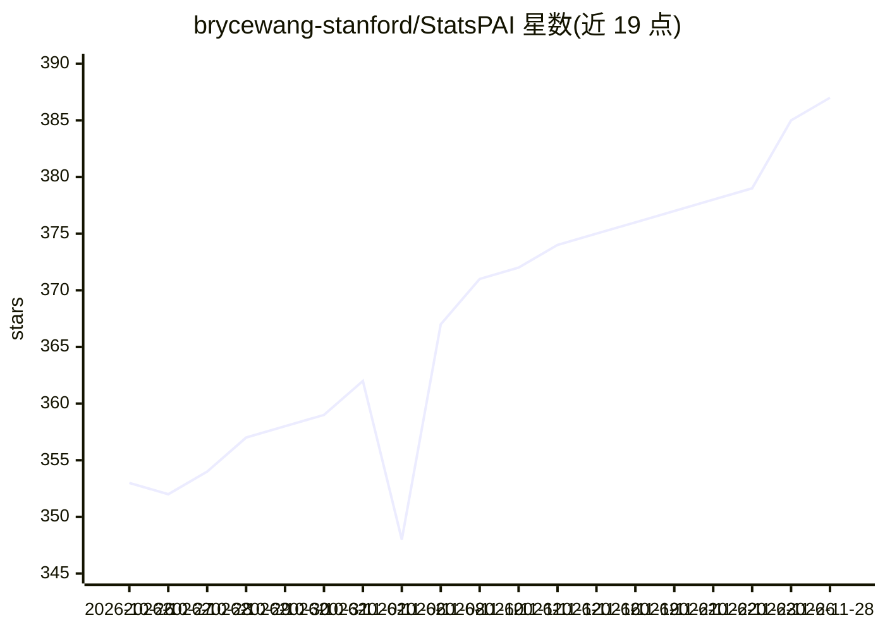

# brycewang-stanford/StatsPAI

⭐ 387 · Python · MIT · 推送 2026-11-27 · [GitHub](https://github.com/brycewang-stanford/StatsPAI) · [官网](https://brycewang-stanford.github.io/StatsPAI/) · 组织维护 · 中文 README

**给实证研究者用 Python 完成因果推断与计量工作流的库**

面向习惯在 Stata、R 与 Python 之间切换的实证研究者，将常见计量与因果推断流程统一到单一 Python API：数据加载、模型估计、诊断、表格导出，并可把结果交给 agent 或 notebook。提供 Stata/R 风格入口（regress、ivregress、csdid、rdrobust 等）、Stata vce 语法、14 个离线数据集，以及 1,692 个注册函数的机器可读 schema 与 statspai-mcp 服务器。每个函数带 validation_status 标注数值对齐证据等级；部分薄封装已弃用。

## 筛选速览

| 维度 | 判定 | 备注 |
|---|---|---|
| AI 角色 | `ai-native` | 本体是模型或模型工具 |
| 许可风险 | `permissive` | MIT |
| 部署形态 | `library` | 以包/库形式分发 |
| 模型依赖 | — | README 未给出锁定关系 |
| 硬件要求 | — | 无带数字的原话,不猜 |
| 安装摩擦 | `low` | 无编译、无系统依赖或容器化 |
| 成熟度 | — | 结构信号不足 |

## 能力要点

- 覆盖 OLS/IV/DiD/RD/合成控制/匹配/双重机器学习等方法的统一 API
- 每个公开函数注册机器可读 schema，附带 statspai-mcp 服务器供 MCP 客户端调用
- 内置 14 个可离线加载的已发表数据集，示例结果由测试锁定
- R/Stata 数值对齐验证，函数带 validation_status 标注

## 适用场景

- 用 Python 复现原 Stata/R 的回归与因果推断流程
- 让 agent 通过 MCP 调用计量估计器做实证分析
- 教学或研究中使用内置经典数据集练习 IV、DiD、RD 等方法

## 场景标签

`数据分析` `科研工具` · 领域:效率与自动化

## 证据(README 行号)

> L24: StatsPAI is for empirical researchers who would normally jump between Stata, R,
> L43: - Agent-native access: every public function is registered with a
> L45:  `sp.function_schema()`), and the bundled `statspai-mcp` server exposes the

## 星数曲线

2026-10-26 353 → 2026-11-28 387（+34）

---
*卡片 v1 · prompt 1.4 · 生成 2026-11-28 · 置信度 mid · 依据 README sha `a3033ac6683a` · [字段定义](../../DATASET.md)*
