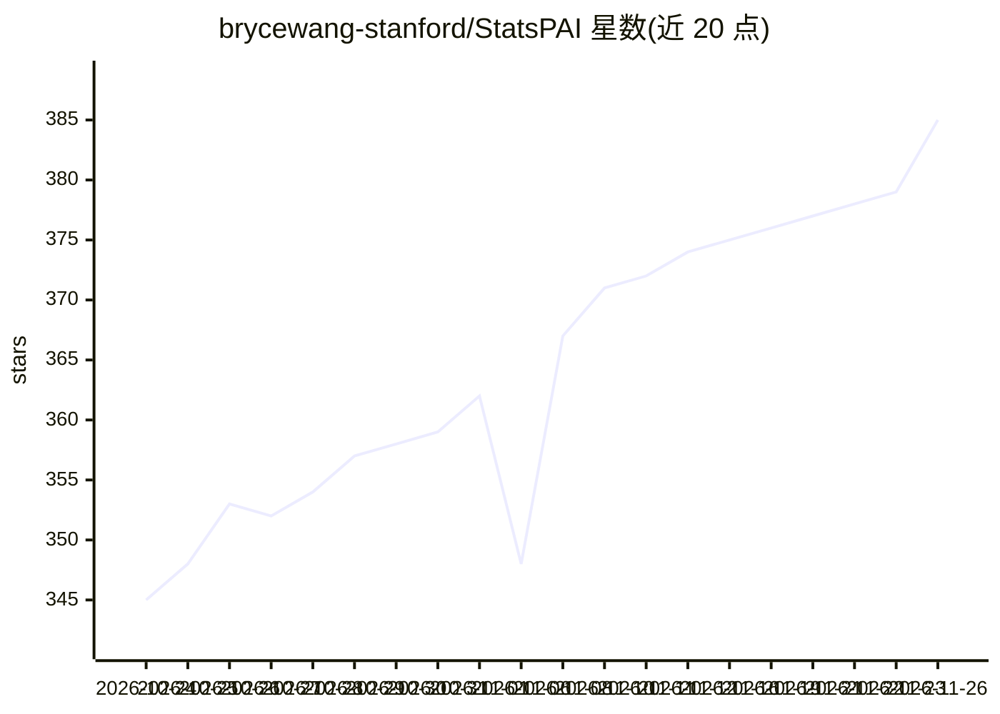

# brycewang-stanford/StatsPAI

⭐ 385 · Python · MIT · 推送 2026-11-25 · [GitHub](https://github.com/brycewang-stanford/StatsPAI) · [官网](https://brycewang-stanford.github.io/StatsPAI/) · 组织维护 · 中文 README

**给实证研究者用 Python 替代 Stata/R 做因果推断，并可被 agent 调用**

面向需要在 Stata、R、Python 之间切换的实证研究者的因果推断与计量经济学 Python 库：以统一 API 覆盖 OLS/IV/固定效应、交叠 DiD、断点回归、合成控制、匹配、双重机器学习等流程，结果对象支持 .tidy()/.to_latex()/.to_docx() 导出。每个公开函数带机器可读 schema，通过捆绑的 statspai-mcp server 暴露给 MCP 客户端；内置 14 个离线数据集、1,691 个注册函数。各估计器带 validation_status 区分数值对齐证据与仅 API 稳定两种情形，发表前需查证。

## 筛选速览

| 维度 | 判定 | 备注 |
|---|---|---|
| AI 角色 | `ai-enhanced` | 去掉 AI 部分产品仍成立 |
| 许可风险 | `permissive` | MIT |
| 部署形态 | `library` | 以包/库形式分发 |
| 模型依赖 | — | README 未给出锁定关系 |
| 硬件要求 | — | 无带数字的原话,不猜 |
| 安装摩擦 | `low` | 无编译、无系统依赖或容器化 |
| 成熟度 | — | 结构信号不足 |

## 能力要点

- 每个公开函数注册机器可读 schema，statspai-mcp server 暴露给 MCP 客户端（Claude Code/Claude Desktop/Cursor 等）
- 遵循 Stata vce() 语法、29 个估计器标准误与 Stata 18 以 1e-6 预算对齐
- 每个函数带 validation_status 区分认证/验证/API 稳定三类证据
- 内置 14 个离线数据集，支持 sp.stata()/sp.from_stata() 直接运行或翻译已有命令

## 适用场景

- 把原有 Stata/R 计量流程迁到 Python 单一 API
- 让代码 agent 通过 MCP 调用计量估计器做实证分析
- 发表研究前查 validation_status 确认估计器的对齐证据等级
- 将 Stata .do 片段翻译为 Python 并交叉核对结果

## 场景标签

 · 领域:统计/计量经济学工具

## 证据(README 行号)

> L43: - Agent-native access: every public function is registered with a
> L46:  estimators to MCP clients such as Claude Code, Claude Desktop, and Cursor.
> L110: At a glance: 1,691 registered functions across 92 submodules; 756k LOC (core) + 519k LOC (tests). Run `python scri

## 星数曲线

2026-10-24 345 → 2026-11-26 385（+40）

---
*卡片 v1 · prompt 1.4 · 生成 2026-11-25 · 置信度 high · 依据 README sha `35cc7f199362` · [字段定义](../../DATASET.md)*
