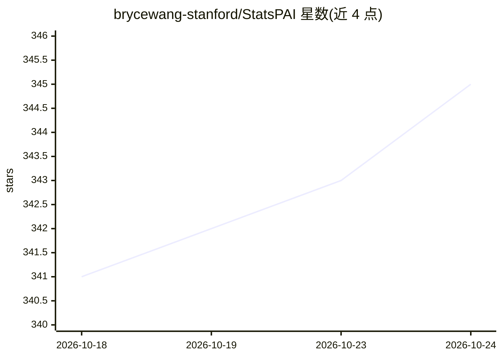

# brycewang-stanford/StatsPAI

⭐ 348 · Python · MIT · 推送 2026-10-24 · [GitHub](https://github.com/brycewang-stanford/StatsPAI) · 组织维护

**Python 因果推断与计量经济学库，供 AI agent 调用 Stata/R 式工作流**

面向在 Stata、R、Python 之间切换的实证研究者，提供统一 API 覆盖 OLS、IV、高维固定效应、交错 DiD、断点回归、合成控制、匹配、双重机器学习等常见计量与因果推断工作流；结果对象支持 summary/tidy/LaTeX/DOCX 导出。每个公开函数注册机器可读 schema，并附带 statspai-mcp 服务器供 Claude Code、Claude Desktop、Cursor 等 MCP 客户端调用。捆绑 14 个离线数据集；各估计器带 validation_status 标注与 R/Stata 数值一致性校验程度，README 明示并非所有命令逐位一致。由斯坦福 REAP 团队开发，发表于 JOSS。

## 筛选速览

| 维度 | 判定 | 备注 |
|---|---|---|
| AI 角色 | `ai-ecosystem` | LLM/agent 周边工具 |
| 许可风险 | `permissive` | MIT |
| 部署形态 | `library` | 以包/库形式分发 |
| 模型依赖 | — | README 未给出锁定关系 |
| 硬件要求 | — | 无带数字的原话,不猜 |
| 安装摩擦 | `low` | 无编译、无系统依赖或容器化 |
| 成熟度 | — | 结构信号不足 |

## 能力要点

- 1,627 个注册函数覆盖 90 个子模块，含 Stata/R 风格估计量与 sp.stata() 直跑 Stata 命令行
- 每个公开函数有机器可读 schema（list_functions/describe_function）
- 附带 statspai-mcp 服务器，可被 Claude Code、Claude Desktop、Cursor 调用
- 29 个估计器的标准误以 1e-6 精度对齐 Stata 18，各函数带 validation_status 标注

## 适用场景

- 在 Python 中复现 Stata/R 的回归、IV、DiD、RD 等实证流程并导出论文表格
- 让 AI agent 通过 MCP 直接执行计量估计与诊断
- 验证既有 Stata 代码在 Python 下的结果一致性

## 场景标签

`科研工具` · 领域:学习与行业

## 证据(README 行号)

> L43: - Agent-native access: every public function is registered with a
> L45:  `sp.function_schema()`), and the bundled `statspai-mcp` server exposes the
> L46:  estimators to MCP clients such as Claude Code, Claude Desktop, and Cursor.

## 星数曲线

2026-10-18 341 → 2026-10-24 345（+4）

---
*卡片 v1 · prompt 1.4 · 生成 2026-10-22 · 置信度 high · 依据 README sha `5369624cbe37` · [字段定义](../../DATASET.md)*
