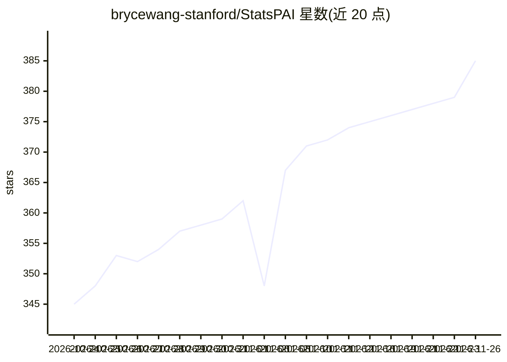

# brycewang-stanford/StatsPAI

⭐ 385 · Python · MIT · 推送 2026-11-25 · [GitHub](https://github.com/brycewang-stanford/StatsPAI) · [官网](https://brycewang-stanford.github.io/StatsPAI/) · 组织维护 · 中文 README

**研究者的 Python 因果推断/计量经济学库，代理可直接调用**

面向习惯在 Stata、R 与 Python 之间切换的实证研究者，提供单一 API 的计量与因果推断工作流：OLS/IV、高维固定效应、交错 DiD、断点回归、合成控制、匹配、双重机器学习等，输出支持 .tidy()/.to_latex()/.to_docx()/.to_agent_summary()。每个公开函数注册机器可读 schema，并内置 statspai-mcp 服务器供 MCP 客户端调用。每个函数带 validation_status 区分数值校验证据与仅 API 稳定状态；Python 3.10–3.13，支持 Linux 与 macOS。

## 筛选速览

| 维度 | 判定 | 备注 |
|---|---|---|
| AI 角色 | `ai-native` | 本体是模型或模型工具 |
| 许可风险 | `permissive` | MIT |
| 部署形态 | `library` | 以包/库形式分发 |
| 模型依赖 | — | README 未给出锁定关系 |
| 硬件要求 | — | 无带数字的原话,不猜 |
| 安装摩擦 | `low` | 无编译、无系统依赖或容器化 |
| 成熟度 | — | 结构信号不足 |

## 能力要点

- 1,692 个注册函数、92 个子模块，统一 Stata/R 风格 API
- 每个函数注册机器可读 schema，附 MCP 服务器（statspai-mcp）
- sp.stata()/sp.from_stata()/sp.from_r() 运行或翻译既有 Stata/R 命令
- 29 个估计量的标准误与 Stata 18 以 1e-6 预算对齐，函数带 validation_status

## 适用场景

- 把既有 Stata .do 文件流程迁移到 Python 并核对结果
- 实证研究中的 DiD、RD、IV、合成控制等估计与论文表格导出
- 让 AI 代理通过 MCP 调用计量估计并获取结构化结果

## 场景标签

`科研工具` · 领域:学习与行业

## 证据(README 行号)

> L24: StatsPAI is for empirical researchers who would normally jump between Stata, R,
> L43: - Agent-native access: every public function is registered with a
> L45:  `sp.function_schema()`), and the bundled `statspai-mcp` server exposes the

## 星数曲线

2026-10-24 345 → 2026-11-26 385（+40）

---
*卡片 v1 · prompt 1.4 · 生成 2026-11-26 · 置信度 high · 依据 README sha `6e2f861f5e9e` · [字段定义](../../DATASET.md)*
