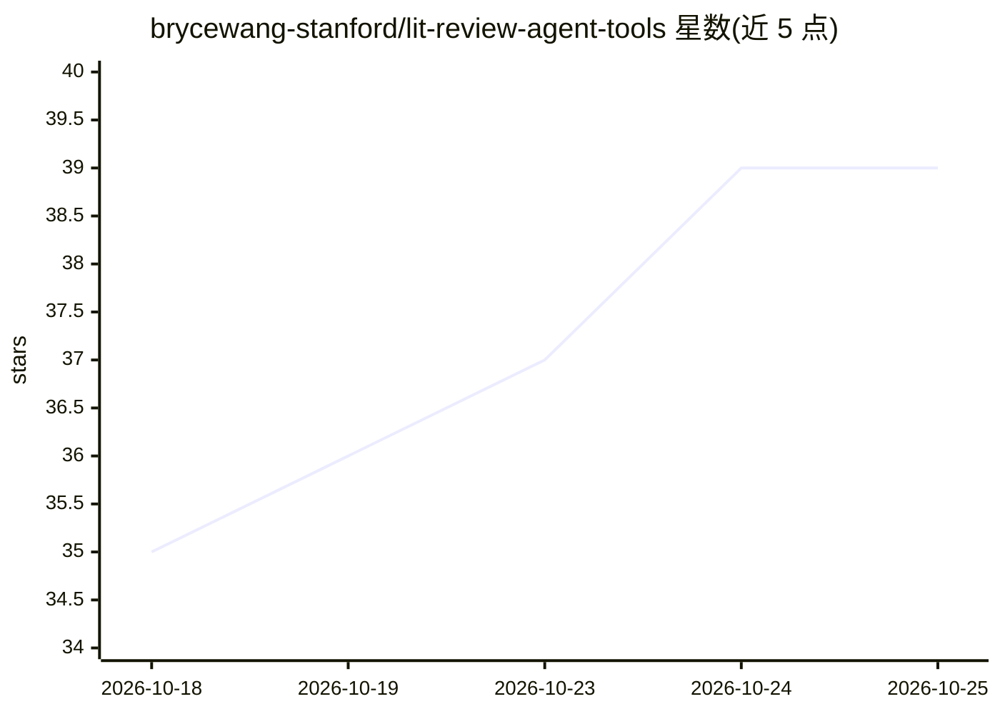

# brycewang-stanford/lit-review-agent-tools

⭐ 39 · Python · CC0-1.0 · 推送 2026-10-19 · [GitHub](https://github.com/brycewang-stanford/lit-review-agent-tools) · [官网](https://brycewang-stanford.github.io/lit-review-agent-tools/) · 个人维护 · 中文 README

**面向文献综述的开源 AI agent 工具策展清单（70+ 工具、11 类）**

由个人维护的 awesome 清单：收录 70 余个用于文献综述全流程的开源 AI agent、Claude Code skills、MCP servers 与框架，按搜索、筛选、提取、阅读、综合、引用核查、写作等 11 个类别组织。每条目标注维护状态与许可证，数据每周从 GitHub API 刷新；其中 6 个工作流经过端到端实际运行验证（含一次无 API key 恢复 33 篇全文的六库检索）。提供可搜索版本、十选推荐、健康报告与数据集，并附完整简体中文版表格。面向需要为科研工作流挑选 AI 工具的研究者与开发者。

## 筛选速览

| 维度 | 判定 | 备注 |
|---|---|---|
| AI 角色 | `ai-knowledge` | 知识聚合/清单类 |
| 许可风险 | `viral` | CC0-1.0 |
| 部署形态 | `None` |  |
| 模型依赖 | — | README 未给出锁定关系 |
| 硬件要求 | — | 无带数字的原话,不猜 |
| 安装摩擦 | `low` | 无编译、无系统依赖或容器化 |
| 成熟度 | — | 结构信号不足 |

## 能力要点

- 70+ 工具按 11 个文献综述工作流阶段分类
- 条目维护状态与许可证每周经 GitHub API 刷新
- 6 个工作流经端到端实际运行验证并记录真实输出
- 提供可搜索版本、十选推荐、健康报告与中文版表格

## 适用场景

- 为文献综述流程挑选可用的开源 AI agent 或 MCP server
- 查看 Claude Code 科研技能与深度研究工具的覆盖情况
- 按维护状态和许可证筛选仍在维护的工具

## 场景标签

`精选清单` `科研工具` · 领域:学习与行业

## 证据(README 行号)

> L1: # Awesome AI Literature Review Awesome
> L3: > Open-source AI agents, skills, MCP servers, and frameworks for literature review.
> L5: Curated tools that help AI agents handle the whole loop of a literature review: search, screen, extract, read, synth

## 星数曲线

2026-10-18 35 → 2026-10-25 39（+4）

---
*卡片 v1 · prompt 1.4 · 生成 2026-10-25 · 置信度 high · 依据 README sha `4da6ee0181db` · [字段定义](../../DATASET.md)*
