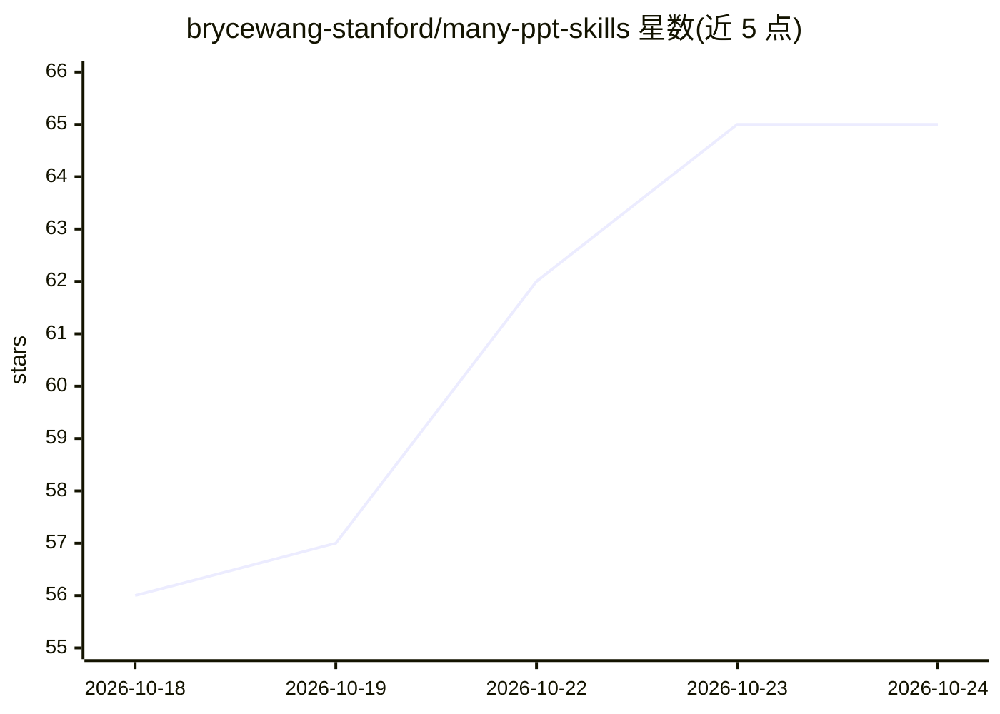

# brycewang-stanford/many-ppt-skills

⭐ 65 · Python · NOASSERTION · 推送 2026-10-24 · [GitHub](https://github.com/brycewang-stanford/many-ppt-skills) · 个人维护 · 中文 README

**227 个 AI 幻灯片 Skill 的对比选型清单，HTML/PPTX 双路线**

收录 227 个 AI 幻灯片生成 Skill/项目的策展清单：按 HTML 路线、原生 PPTX 路线与双路线组织，附 star 数、License 与一句话说明，数据由 data/skills.json 自动生成刷新。提供 436 张 README 样图图库，用户可按图索骥抄风格 ID 再照三步流程复刻；仓库本身也打包为一个 Claude Code skill，装上后由 agent 代为选型，另带 pick.py 命令行查询层。它只做选型，不生成 deck。限制：收录条目 39 个人工读过，排名信息以各项目 SKILL.md 为准。

## 筛选速览

| 维度 | 判定 | 备注 |
|---|---|---|
| AI 角色 | `ai-knowledge` | 知识聚合/清单类 |
| 许可风险 | `none` | NOASSERTION |
| 部署形态 | `library` | 以包/库形式分发 |
| 模型依赖 | — | README 未给出锁定关系 |
| 硬件要求 | — | 无带数字的原话,不猜 |
| 安装摩擦 | `low` | 无编译、无系统依赖或容器化 |
| 成熟度 | — | 结构信号不足 |

## 能力要点

- 227 个 skill 按 HTML/PPTX/双路线分类，含 star 与 License 登记
- 样图图库 + 风格 ID 三步复刻流程（60 秒做出同款）
- 仓库本身可作为 Claude Code skill 安装，由 agent 代为选型
- pick.py 命令行查询层支持按路线/风格/关键词检索

## 适用场景

- 我需要做一个幻灯片，先来这里确定走 HTML 还是 PPTX 路线
- 从 436 张样图中挑样式，抄风格 ID 让 agent 复刻
- 让 agent 根据我的场景直接推荐 skill 与安装命令

## 场景标签

`精选清单` · 领域:学习与行业

## 证据(README 行号)

> L11: **收录 227 个 skill**，其中 **39 个人工读过** · **合计 303,918 star** · HTML 路线 83 个 · PPTX 路线 79 个 · 双路线 25 个 · 数据刷新于 **2026-09
> L21: 1. **全部收齐** —— 两条路线值得知道的 skill 都在，带实时数据。由
> L89: **它只做选型，不生成 deck**，也不会替你编造别人项目的调用语法 —— 那以各项目自己的

## 星数曲线

2026-10-18 56 → 2026-10-24 65（+9）

---
*卡片 v1 · prompt 1.4 · 生成 2026-10-24 · 置信度 mid · 依据 README sha `534b20c70399` · [字段定义](../../DATASET.md)*
