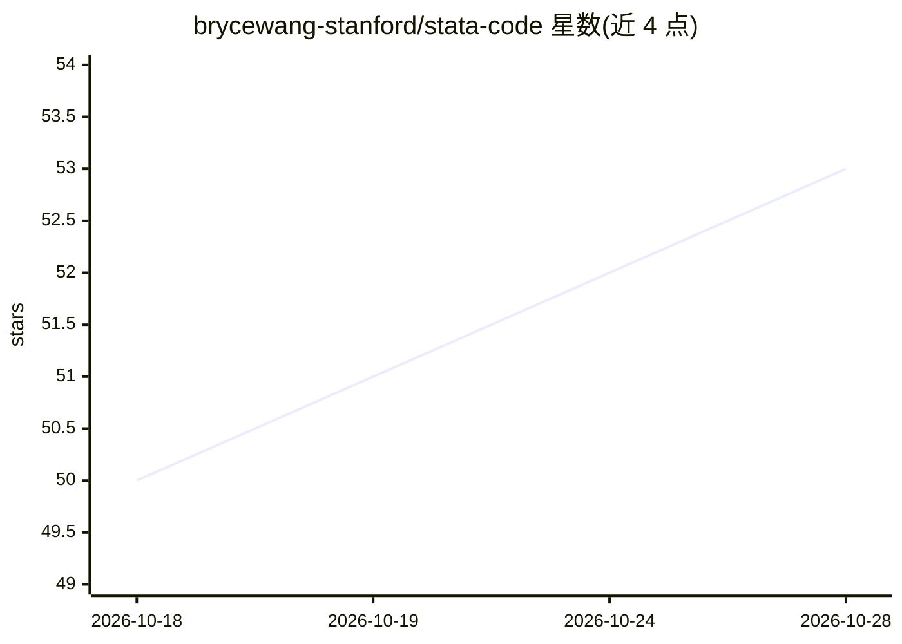

# brycewang-stanford/stata-code

⭐ 54 · Python · MIT · 推送 2026-10-27 · [GitHub](https://github.com/brycewang-stanford/stata-code) · 组织维护 · 中文 README

**让 LLM 智能体与 Jupyter/VS Code 驱动 Stata 跑实证研究的桥接工具**

一个 Python 核心加多种前端的 Stata 桥接器：提供 MCP server、Jupyter kernel、VS Code 扩展和终端命令行四种入口，供 Claude Code、Cursor 等 LLM 智能体及普通用户从现代开发环境执行 Stata 代码。返回统一的结构化、省 token 的 RunResult（typed errors、原生 r()/e()），支持 pystata（Stata 17+）与 console（Stata 13+）两种后端，内置命令安全护栏拦截 shell/删文件类命令，提供会话 daemon 跨调用保持数据，并配合 StatsPAI 做跨栈交叉验证（DiD/IV/RDD 等 recipe）。需本机装有 Stata。MIT 许可。

## 筛选速览

| 维度 | 判定 | 备注 |
|---|---|---|
| AI 角色 | `ai-ecosystem` | LLM/agent 周边工具 |
| 许可风险 | `permissive` | MIT |
| 部署形态 | `library` | 以包/库形式分发 |
| 模型依赖 | — | README 未给出锁定关系 |
| 硬件要求 | — | 无带数字的原话,不猜 |
| 安装摩擦 | `low` | 无编译、无系统依赖或容器化 |
| 成熟度 | — | 结构信号不足 |

## 能力要点

- MCP server / Jupyter kernel / VS Code 扩展 / CLI 共享同一 Python 核心与结果 schema
- 支持 Stata 17+（pystata）或 Stata 13+（console 后端），零 Python 独立二进制
- 默认命令安全护栏，拦截 shell/erase/! 等 OS 逃逸与删文件命令
- 常驻 daemon 通过 Unix socket 让多次 CLI 调用共享内存中 Stata 会话数据

## 适用场景

- 在 Claude Code 里用自然语言跑 DiD/IV/RDD 并输出 esttab 出版级表格
- 在 Jupyter notebook 中直接写 Stata 命令并内联查看日志与图形
- 让无人值守 agent 循环执行 Stata 代码且依赖安全护栏防止误操作

## 场景标签

`数据分析` `科研工具` · 领域:效率与自动化

## 证据(README 行号)

> L25:  stata-code: agent-native Stata bridge — one Python core, multiple frontends (Jupyter kernel, MCP server, VS Code e
> L29: `stata-code` 让你可以从现代开发环境中驱动 Stata：LLM 智能体（Claude Code、Cursor、Claude Desktop）、Jupyter notebook，或 VS Code 编辑器。它们共享同一个
> L45: **为什么选 `stata-code`：** MIT 许可证 · 同时提供 MCP server、内置 agent skill、Jupyter kernel、VS Code 扩展 **和** 终端命令行（`stata-code r

## 星数曲线

2026-10-18 50 → 2026-10-28 53（+3）

---
*卡片 v1 · prompt 1.4 · 生成 2026-10-24 · 置信度 high · 依据 README sha `57663c889b77` · [字段定义](../../DATASET.md)*
