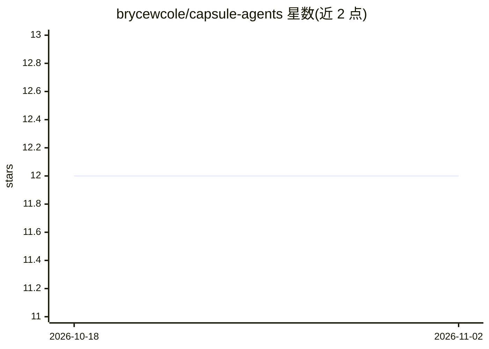

# brycewcole/capsule-agents

⭐ 12 · TypeScript · NOASSERTION · 推送 2026-01-12 · [GitHub](https://github.com/brycewcole/capsule-agents) · 个人维护

**容器化 A2A 协议 agent 的创建与运行平台**

通过 Docker 容器封装 Agent-to-Agent（A2A）协议兼容的 agent，每个 agent 自带 SQLite 状态存储、真实 shell 环境和可执行/自建 CLI 工具；提供无代码 Web 配置界面（/editor）或配置文件两种创建方式，支持接入远程 MCP 服务器（如 GitHub、Tavily），可与 LangGraph、n8n 等 A2A 系统通信。安装仅需 Docker 与 API key 环境变量，一条 docker run 命令启动。

## 筛选速览

| 维度 | 判定 | 备注 |
|---|---|---|
| AI 角色 | `ai-ecosystem` | LLM/agent 周边工具 |
| 许可风险 | `none` | NOASSERTION |
| 部署形态 | `self-host` | docker 或自建部署 |
| 模型依赖 | — | README 未给出锁定关系 |
| 硬件要求 | — | 无带数字的原话,不猜 |
| 安装摩擦 | `low` | 无编译、无系统依赖或容器化 |
| 成熟度 | — | 结构信号不足 |

## 能力要点

- A2A 协议原生互通，可连接 LangGraph、n8n 等
- 无代码 Web 界面或配置文件创建 agent
- 每个 agent 为自包含开源容器，状态存于本地 SQLite
- 支持远程 MCP 服务器接入与集成工作区 UI

## 适用场景

- 不写代码快速创建可互通的 A2A agent
- 搭建多 agent 协作环境
- 给 agent 接入 GitHub、Tavily 等 MCP 工具

## 场景标签

`Agent 框架` `多智能体` · 领域:Agent 开发

## 证据(README 行号)

> L9: Capsule Agents is designed to make it as easy as possible to create Agent-to-Agent (A2A) protocol compatible agents,
> L21: - **A2A Native**: Designed to work seamlessly with the A2A protocol, making it easy to connect and communicate with

## 星数曲线

2026-10-18 12 → 2026-11-02 12（+0）

---
*卡片 v1 · prompt 1.4 · 生成 2026-11-01 · 置信度 high · 依据 README sha `4505174e4a9a` · [字段定义](../../DATASET.md)*
